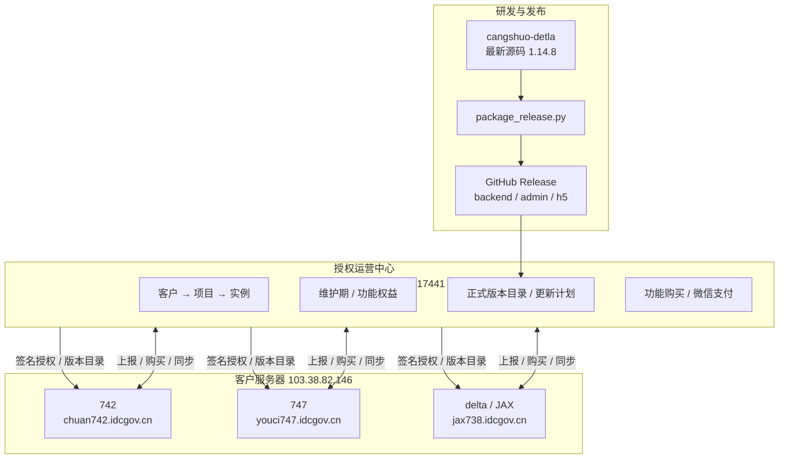

# Delta 生态 Vibe Coding 规则

最后更新：2026-11-13（Asia/Shanghai）
文档版本：2026-11-13.3

读取回执：每次新会话第一次实质性回复必须包含一行“已读取 VIBE_CODING.md v2026-11-13.3”。如果本次没有读取，不要开始改代码，先补读。修改本文件时必须同步提升文档版本。

适用范围：

- Delta 电竞客户端最新源码：`D:\codeStudy\code\cangshuo-detla`
- 授权运营中心：`D:\codeStudy\code\cangshuo-detla-authorize`
- 客户部署副本：`742`、`747`、`detla738`

本文件是每次 AI 协作会话的必读入口。开始设计、改代码、改数据库、改授权、打包或发布前，先读本文件，再读与目标项目对应的实现文档和实际代码。不要把本文件当成发布说明；版本、发布和授权规则的具体执行仍以 `docs/development-conventions.md` 和授权中心当前数据为准。

## 0. 规则优先级

发生冲突时按以下顺序判断：

1. 用户在当前会话中的最新明确指令。
2. 全局 `AGENTS.md`、项目 `AGENTS.md` 和工作区规则。
3. `docs/development-conventions.md`：正式版本、发布、安全和数据库约定。
4. 本文件：项目关系、工作流程和当前事实。
5. `docs/客户实例与授权中心关系.md`、`docs/项目结构说明.md` 和客户部署文档。
6. 实际代码、数据库、构建结果和生产状态。

历史文档只说明当时的决策。若历史文档与最新用户要求、当前代码或授权中心数据冲突，以最新事实为准，并在本次任务中修正文档。

## 1. 每次会话的开工顺序

每次开始任务，按以下顺序建立上下文：

1. 读本文件。
2. 读 `docs/development-conventions.md`，确认版本、分支、发布、安全和数据库规则。
3. 读 `docs/客户实例与授权中心关系.md`，确认这次改动属于最新源码、授权中心还是某个客户实例。
4. 读 `docs/项目结构说明.md` 和目标项目的 `README.md`、部署文档。
5. 检查 `git status`、当前分支、最近提交；不要假设工作区干净。
6. 只读检查目标页面、接口、Service、Mapper、数据库表和已有测试。
7. 用一小段话说明本次范围、会改哪些文件、怎么验证；范围不清楚时先做只读核对。
8. 实现最小闭环，完成对应测试或明确说明无法执行的原因。
9. 同步文档、版本号、发布说明和授权配置说明。
10. 最后报告实际改动、实际执行的命令、通过/失败/未执行的结果和剩余风险。

不要凭项目名称猜版本，不要凭本地目录猜生产状态，不要把客户副本当最新源码。

## 2. 必须理解的项目关系

### 2.1 一句话

`cangshuo-detla` 是产品主线；JAX、742 和 747 运行在同一个共享服务组（各自独立数据库、文件、授权和管理员），`cangshuo-detla-authorize` 是独立的授权控制面；GitHub Release 是正式制品仓库。

这不是一个数据库里的三个租户。JAX、742 和 747 共享 Java/MySQL/Redis 服务组，但各自有独立数据库、租户文件目录、域名、管理员账号和授权实例 UUID；三套业务数据和授权状态不能混用。

### 2.2 全景



### 2.3 三个客户

| 客户 | 生产域名 | 生产客户端版本 | 本地目录 | 服务器部署 | 入口端口 |
| --- | --- | ---: | --- | --- | --- |
| 742 | `chuanapi742.idcgov.cn` / `chuan742.idcgov.cn` | 1.14.8 | `D:\codeStudy\code\742`，本地为 1.2.0 | 共享服务组；旧 `/opt/apps/742` 仅回退 | 8081 / 8082；旧 7420/7421 已停 |
| 747 | `youciapi747.idcgov.cn` / `youci747.idcgov.cn` | 1.14.8 | `D:\codeStudy\code\747`，本地为 1.5.12 | 共享服务组；旧 `/opt/apps/747` 仅回退 | 8081 / 8082 |
| delta / JAX | `jaxapi738.idcgov.cn` / `jax738.idcgov.cn` | 1.14.8 | `D:\codeStudy\code\detla738`，旧 master | 共享服务组 `/www/delta` | 8081 / 8082 |

生产版本按 2026-11-13 的共享组 1.14.8 全面验收和授权中心记录整理。客户版本以后还会变化，做发布或升级前要重新核对授权中心，不要只信这张表。

`delta` 与本地 `detla738` 的对应依据是旧仓库的域名、部署记录和 CORS 默认值曾经指向 `jax.kkimg.top` / `jaxapi.kkimg.top`；2026-11-11 生产已切换为 `jax738.idcgov.cn` / `jaxapi738.idcgov.cn`，授权中心把第三套生产项目登记为 `delta`。

`742` 的本地版本按 `catalog.json` 记为 1.2.0；其前端 `package.json` 仍为 0.0.0，说明这份副本的版本号本身就不完整，不能作为正式发布基线。

### 2.4 不在 Delta 授权体系内的目录

- `743` 当前是空目录，不是客户实例。
- `744` 是 PERSONA 小众文化体验馆，独立 Node/微信小程序项目，不属于 Delta 电竞系统和授权中心。
- `cangshuo-scpu`、`cangshuo-timetable`、`cangshuo-tool`、`web`、`uniapp` 等是其他项目或资料，除非用户明确说纳入本次范围，否则不要混入 Delta 授权关系。
- `万维`、`frp`、`nodejs_server` 等目录也不默认属于 Delta 产品线。

### 2.5 授权中心对象模型

| 对象 | 作用 |
| --- | --- |
| 客户 Customer | 商务主体 |
| 项目 Project | 维护期、商务金额、通知邮箱、默认支付通道、暂停策略 |
| 实例 Instance | 实际部署的 UUID、域名、客户端版本、功能权益 |
| 软件 Product | 当前电竞软件编号 `detla`，仓库 `zhz520/cangshuo-detla` |
| 功能模块 Module | 可单独售卖的付费能力 |
| 权益 Entitlement | 实例对某个模块的生效/到期/启用状态 |
| 授权 License | 绑定客户、实例、域名、维护期和功能集合的签名凭据 |
| 版本 Release | GitHub 正式版本、组件、摘要和更新项 |

授权中心决定“有没有购买、是否在有效期内”；客户管理员在本地后台决定“是否实际启用”。两者都满足，功能才真正可用。

## 3. 事实来源，不要混淆

| 事实 | 可信来源 | 不要使用 |
| --- | --- | --- |
| 最新源码版本 | `cangshuo-detla` 的 `catalog.json`、两个前端 `package.json`、小程序 `manifest.json` | 客户副本的旧版本 |
| 客户生产版本 | 授权中心的实例 `client_version` 和最近上报时间 | 本地客户目录的 `package.json` |
| 客户域名和端口 | 客户部署目录的 `deploy/production/README.md`、生产 `.env`、反代配置 | 代码里的旧默认值 |
| 客户是否已接自助更新 | 服务器 systemd、`worker.json`、更新执行器日志 | 仅凭代码里有 `worker.py` |
| 授权关系 | 生产授权中心数据库/后台 | 本地空的 `.local/authority.sqlite` |
| 数据库实际结构 | 生产 MySQL 和迁移记录 | 只读实体类或 H2 测试库 |
| 服务器实际容器 | 生产 `docker ps`、Compose 项目名、宝塔站点 | README 里的示例端口 |

当前已知情况：

- 最新源码和正式基线为 1.14.8；1.14.8 已于 2026-11-13 完成已注销账号手机号释放、重新注册和管理员安全删除打手，并补齐待结算收益的删除阻断，完成 GitHub Release、授权中心同步和三个组件摘要登记。
- JAX、742 和 747 已于 2026-11-13 通过 `delta-shared-prod` 服务组签名计划统一升级到 1.14.8；发布计划 `c37feb6b-2879-4960-a36c-b1bbfd35c3ca` 的审计结果为 `SUCCEEDED`，三实例上报 `current=1.14.8`、`latest=1.14.8`。
- 共享组更新规则以 `docs/共享服务组更新入口与发布规则.md` 为准：客户后台显示“此实例尚未接入更新执行器”是共享实例的预期现象；不得调用实例更新计划或旧 `worker.py`。
- 747 已完成 `1.5.15 → 1.11.2 → 1.12.2 → 1.12.3 → 1.12.4`，随后迁入共享组；旧 747 backend/admin/H5/MySQL/Redis 和 updater 已停止并禁用，旧数据和发布目录保留。
- JAX、742、747 已于 2026-11-11 完成域名切换：JAX `jaxapi738.idcgov.cn` / `jax738.idcgov.cn`，742 `chuanapi742.idcgov.cn` / `chuan742.idcgov.cn`，747 `youciapi747.idcgov.cn` / `youci747.idcgov.cn`；授权许可证、共享租户注册、Nginx、Compose 健康检查和业务 URL 均已同步，旧域名不再作为生产入口。
- 1.12.4 修复共享服务组中 `@Async` 未使用租户传播执行器、异步通知丢失租户上下文的问题；授权中心已登记 1.12.4 三个必选更新项，JAX/742/747 共享后端和静态入口已部署并验证。
- 1.12.3 修复共享租户 license 使用全局客户编号的问题；JAX/742 的 1.12.3 授权上报已验证。
- 本地授权数据库只是开发初始化数据，不能用来判断生产客户、项目、实例和权益。
- 系统 PATH 中没有 Maven，默认 Java 为 25；正式构建使用缓存 Maven 3.9.11 和 Temurin JDK 17（临时目录）。不要用 Java 25 代替项目要求的 Java 17。

## 4. 版本号规则

### 4.1 正式版本格式

正式版本统一使用 `MAJOR.MINOR.PATCH`。

| 段位 | 使用条件 | 当前基线下的例子 |
| --- | --- | --- |
| MAJOR | 不兼容变更、授权/更新协议不兼容、需要整体迁移 | `2.0.0` |
| MINOR | 新增完整业务能力或一组明显可见的功能 | `1.12.0` |
| PATCH | 正式版后的缺陷、安全或线上阻塞修复 | `1.14.2` |

当前正式基线是 `1.14.8`。后续常规缺陷/安全修复使用 `1.14.9`，新功能批次使用 `1.15.0`。不要因为改了文档、加了一个测试、修了一个错别字就升版本；同一批验收中的多个小修复合并为一个发布版本。

### 4.2 预览版

- 预览版使用 `x.y.z-preview.N`。
- 预览版不能进入客户正式更新目录。
- 预览版不能创建正式 Release 标签。
- 预览版升级为正式版时，版本号按实际变更选择 MINOR 或 PATCH，不沿用 preview 后缀。

### 4.3 多端版本必须对齐

后端、管理后台、H5、微信小程序必须使用同一个正式版本号。更新执行器按三个可部署组件的最低版本判断当前版本，避免后端更新了、后台或 H5 还没更新的“假最新”状态。

### 4.4 版本升级清单

每次正式发布必须同步检查：

- `delta-game/delta-admin/src/main/resources/platform/catalog.json` 的 `version`、`schemaVersion`、`releaseNotes` 和新增功能的 `minVersion`。
- `delta-admin-ui/package.json` 和 `package-lock.json`。
- `delta-mp/package.json` 和 `package-lock.json`。
- `delta-mp/manifest.json` 的 `versionName` 和 `versionCode`。
- `docs/x.y.z-发布说明.md`。
- `docs/client-feature-integration.md` 中“当前正式版”的描述（如有）。
- GitHub 正式标签、Release 标题、Release 说明和更新项。
- 授权中心同步后的 `release_catalog`、组件资产和 SHA-256。
- 客户侧 `cangshuo-version.json` 或组件版本文件的预期值。

不要只改后端 `catalog.json`。不要只改前端 `package.json`。不要在没有发布说明的情况下创建正式标签。

### 4.5 标签和版本不可变

- 正式标签一经发布不可改写、移动或复用。
- 同一版本需要修复时发布新的 PATCH，不重打旧标签。
- `package_release.py` 会拒绝脏工作区、已存在标签和预览版本；不要绕过这些检查。
- 授权中心只接受带 SHA-256 digest 的正式 Release 资产；缺少摘要、草稿、预览版不能安装。

## 5. 分支、提交和合并

- 功能分支：`codex/<功能简述>`。
- 紧急修复：`codex/hotfix-<问题简述>`。
- `main` 始终保持可构建、可发布；不要直接在 `main` 写未验证功能。
- 提交信息使用 `type: summary`：`feat:`、`fix:`、`security:`、`refactor:`、`test:`、`docs:`、`release:`。
- 一个提交只处理一个主题。
- 合并前同步最新主分支，解决冲突，确认自动测试和构建通过。
- 不提交密码、私钥、JWT、GitHub Token、微信支付密钥、数据库凭据、客户真实数据、上传文件和本地缓存。

## 6. 发布和更新规则

正式发布链路固定为：

1. 开发完成并通过验收。
2. 同步所有版本文件和发布说明。
3. 从干净工作区、固定 commit 构建后端、管理端和 H5。
4. `deploy/updater/package_release.py` 打包 `cangshuo-backend.zip`、`cangshuo-admin.zip`、`cangshuo-h5.zip`。
5. 生成 `release-manifest.json`，包含 Git commit、工作区状态和三个 SHA-256。
6. 创建 GitHub 正式标签和 Release，上传全部资产。
7. 授权中心检查正式 Release，读取 digest，登记必要更新项和可选更新项。独立实例还需核对客户后台的更新内容；共享服务组还需生成服务组计划。
8. 根据部署形态选择执行通道：独立实例由客户管理员在后台选择更新项并点击安装；JAX、742、747 共享组由发布方在维护窗口生成 `cangshuo-shared-release-v1` 计划并交给 `cangshuo-shared-worker.service`。
9. 独立实例未经客户点击，发布方不代为安装。共享服务组不存在租户独立点击入口，平台统一发布必须使用服务组计划、逐租户备份、组件健康检查和失败回退。
10. 客户服务器执行器验签、校验摘要和版本、备份 MySQL/文件、切换组件、健康检查、失败回退。
11. 记录发布版本、提交号、资产摘要、服务组或实例计划 ID、审计结果和验收结果。

共享服务组的详细入口、API、私有 inbox、证据和禁止事项见 `docs/共享服务组更新入口与发布规则.md`。不要把实例更新计划和共享服务组计划混用。

禁止：

- 不使用预览标签替代正式版。
- 不使用旧构建产物冒充新版本。
- 不在脏工作区打包正式资产。
- 不在每次 CI 推送中上传后端、后台或 H5 大附件。
- 不让客户依赖私有 GitHub 链接下载更新。
- 不在缺少 SHA-256 digest 时开放安装。
- 不把“总体版本号”当成“所有组件已更新”的证据。
- 不在未备份时执行更新。
- 不让更新执行器接受任意服务器命令、路径或数据库迁移。

数据库更新边界：

- 更新执行器只接受 `schemaVersion=1`，不执行任意数据库迁移。
- 新增字段和新增表由 `DatabaseCompatibility` 在启动时做兼容检查。
- 新版本涉及表结构时，必须同时增加独立迁移文件、兼容检查和测试。
- 破坏性变更、数据改写和复杂回退必须单独设计，不能靠替换三个 ZIP 完成。

## 7. 授权、客户和数据边界

- 授权中心只保存客户、项目、实例、维护期、模块、订单、发布和授权元数据，不保存客户订单、用户、聊天、钱包和上传文件。
- 客户业务流量直接访问各自后端；授权中心只是控制面，不是业务网关。
- 客户端只持有验证公钥；签发私钥只保存在授权中心受保护目录。
- 授权绑定客户、实例、域名和维护期；修改域名后必须同步更新授权中心的实例域名并重新签发。
- 删除 `PLATFORM_STATE_PATH` 会改变实例 UUID，需要重新登记授权。
- 客户本地启用开关与授权中心授权分离；不要用授权中心替代客户后台的实际启用操作。
- 不跨客户复制 MySQL、Redis、uploads、`.env`、支付证书、短信密钥、公众号密钥、管理员账号和业务数据。
- 客户副本只保存客户主题、配置和部署差异；不要把三个客户改成三套不同架构。

## 8. 安全底线

- 权限必须在后端校验，不能只靠前端隐藏按钮。
- 订单、聊天、投诉、支付、退款、提现必须校验资源归属。
- 游客只能访问本人订单、聊天、投诉、支付和必要上传。
- 支付回调必须验签，并校验商户号、AppID、金额、交易号、本地支付单和业务类型；重复回调必须幂等。
- 退款、余额、结算和提现必须使用数据库事务和行锁，不能只依赖 Redis 锁。
- 金额、支付状态、退款状态和授权状态以服务端数据为准，不信任客户端参数。
- 私钥、API v3 密钥、证书、JWT、数据库密码、短信 AccessKey、GitHub Token 不得进入代码、日志、文档、截图或对话。
- 上传必须校验真实文件签名、MIME、扩展名、大小和图片解码；不要信任浏览器声明。
- 管理端敏感操作必须校验具体权限并写入操作日志。
- 手机号、证件等敏感信息必须脱敏；完整联系方式只向管理员、客服及明确授权人员开放。
- 日志不得记录密码、授权码、JWT、支付密钥、完整证件信息或游客查单凭证。

## 9. 数据库和迁移规则

- 默认采用新增表、新增可空列或带安全默认值的加列。
- 不删除字段、不覆盖历史业务数据、不在生产库做不可逆实验。
- 迁移脚本必须可重复执行；关键新增列先查 `information_schema`。
- 新版本涉及表结构时，必须同时维护启动兼容逻辑和独立迁移文件。
- 升级前备份数据库、上传文件、环境文件和实例状态。
- 金额、订单状态、退款、结算和授权相关 SQL 必须有回归测试。
- H2 测试不能替代 MySQL 方言、锁和索引验证；涉及复杂 SQL 时要说明验证范围。
- 数据库 `schemaVersion` 必须与更新协议一致；没有回退方案的破坏性迁移不得直接发布。

## 10. 代码边界

### 后端

- 主流程保持 `Controller -> Service -> Mapper -> Entity`。
- 跨模块业务通过 Service 接口或 `CrossModuleMapper`，不要制造模块循环依赖。
- `delta-common` 只放通用安全、响应、异常、聊天、文件、Redis、短信、公众号等基础能力。
- `delta-admin` 目前同时承担启动、后台接口、统计、通知、平台授权和待办，文件集中度高；新增功能优先放到对应业务模块，不要继续无边界堆进 `delta-admin`。
- Controller 不新增业务事务；复杂事务放到 Service。现有 Controller 中的事务是历史结构，不要复制。
- 退款、待办、治理等复杂 SQL 可能直接使用 `JdbcTemplate`，排查时要同时看 Service、Mapper 和 SQL。

### 管理后台

- 后台 PC 固定 `/`，手机端固定 `/h5`；不要恢复按窗口宽度自动跳转，`/mobile` 已移除，仅保留静态兼容分流脚本。
- H5 使用独立 `H5Layout` 移动壳，不复用 PC 的侧栏、面包屑和通知栏；H5 的 403、404 也必须留在移动壳内。
- H5 内部跳转到规范 PC 路径时必须保留历史记录，顶部返回和浏览器返回都要回到上一个 H5 页面；直接打开深链时返回 `/h5/dashboard`。
- PC 在手机宽度下保持“紧凑电脑版”：顶部菜单抽屉、桌面仪表盘和桌面信息密度；不得再复用 H5 底部导航和移动工作台。
- 工作人员头像统一使用 `StaffAvatar`：上传头像优先，其次品牌 Logo，最后品牌名称首字。
- 页面请求统一走 `src/api/*` 和 `src/utils/request.js`，页面不散落 URL。
- 路由权限同时看 `meta.roles`、`meta.permission` 和 `meta.feature`。
- 新增页面必须接入权限守卫、菜单过滤和移动端路由别名。
- 不把后端权限判断复制成唯一安全边界；前端隐藏只负责体验。
- 付费功能必须同时校验员工权限和授权中心功能可见性。

### 移动端

- 新增页面必须写入 `pages.json`；未注册页面不会进入构建产物。
- `pages-cs` 的绝大多数业务页已经退役，只有登录跳转页注册；客服和后台功能走管理后台 `/h5`，`/mobile` 已移除。
- 小程序、H5、微信内置浏览器要分别验证；不能用一个环境的结果代替全部。
- 客户、打手、客服、管理员角色入口和 Token 分开，不要混用身份。

### 授权中心

- `server/store.mjs`、`management.mjs`、`http.mjs`、`releases.mjs`、`payments.mjs` 分别负责核心数据、管理、协议、版本和支付。
- 授权中心不承载客户业务数据，也不执行客户服务器命令。
- 公开版本说明页、客户端上报、更新计划和制品下载要分别测试。
- 授权中心数据库和私钥备份必须一起保存；不能只备份 SQLite 而丢失密钥。

### 更新执行器

- 独立实例使用 `worker.py`，由宿主机 systemd 管理，不监听新端口。
- JAX、742、747 共享组使用 `shared_worker.py` 和 `cangshuo-shared-worker.service`；只接收 `cangshuo-shared-release-v1` 签名计划，不接受实例计划。
- 共享组更新必须先读 `docs/共享服务组更新入口与发布规则.md`；客户后台的实例更新提示不能作为共享部署状态依据。
- 只接受签名计划，不接受客户端提供的服务器命令、路径或密码。
- 安装前备份，安装后健康检查，失败回退；回退失败保持维护状态。
- 更新执行器不执行任意数据库迁移。

## 11. 测试和验证

按改动范围选择命令，只报告实际执行过的结果：

```powershell
# 后端（在 delta-game 目录）
mvn -pl delta-admin -am verify

# 管理后台
Set-Location D:\codeStudy\code\cangshuo-detla\delta-admin-ui
npm test
npm run build

# 移动端 / H5 / 小程序
Set-Location D:\codeStudy\code\cangshuo-detla\delta-mp
npm test
npm run build:h5
npm run build:mp-weixin

# 授权中心
Set-Location D:\codeStudy\code\cangshuo-detla-authorize
npm test
npm run build

# 更新执行器
Set-Location D:\codeStudy\code\cangshuo-detla
python deploy\updater\test_worker.py
```

最低验证要求：

- 后端改动：对应单元/集成测试、权限和异常路径、数据库兼容。
- 管理端改动：单测、生产构建、路由守卫和移动端布局。
- H5/小程序改动：单测、H5 构建、小程序构建、登录和支付返回路径。
- 支付、退款、结算、授权改动：必须新增覆盖幂等、并发、金额和状态流的测试。
- 授权中心改动：登录、CSRF、版本同步、更新计划、制品下载、邮件和支付。
- 更新执行器改动：签名、摘要、组件版本、备份、健康检查、回退和中断恢复。

系统 PATH 没有 Maven 时，不要伪造后端测试通过；说明未执行，并给出 CI 命令。Java 25 不能替代项目要求的 Java 17 验证；本次使用 Temurin JDK 17 和缓存 Maven 3.9.11 实际执行。

2026-11-11 本次检查记录：

- 管理后台 `npm test`：70 项通过。
- 移动端 `npm test`：87 项通过。
- 后端：316 项测试通过，0 failures / 0 errors；使用 Temurin JDK 17.0.21 和 Maven 3.9.9。
- 更新器 28 项、迁移工具 21 项测试通过。
- 管理后台、H5 和微信小程序生产构建通过。
- 真实嵌入式 Tomcat 握手验证：允许来源 101，跨租户来源 403；MVC 缺失静态资源返回 404。
- JAX 扩展验收：45 个 PC 路由和 45 个 H5 路由逐页加载；生产游客下单、客服聊天、PNG 上传/缩略图通过，测试数据已清理；隔离数据库完成余额支付、指派、接单、进度、聊天、完成、确认、两阶段退款、提现申请/拒绝和投诉，财务 12 项 0 违规。
- 系统配置双重编码文本已修正 10 条；`/admin/settlements` 缺少必填日期参数时仍返回 500，已登记为下一补丁的低优先级参数校验问题。
- 客户 H5 手工部署曾因 Linux `unzip` 错误转码 54 个中文文件名，导致 4 个动态 JS chunk 缺失；已用 Python `zipfile` 重解压到 `jax-1.12.1-h5fix-20261111-1455`，280 个文件、动态引用缺失 0，刷新后无控制台错误。
- 静态容器 Nginx 模板已增加 `/assets/`、`/static/` 缺失资源 404 和入口文件禁缓存规则；手工部署必须用 Python `zipfile` 或等效 UTF-8 解压，不要使用会转码文件名的 `unzip`。
- 已增加 `deploy/qa/check_static_assets.py`：打包前和 CI 构建后检查所有静态引用；可用 `--archive` 校验 ZIP 与实际解压目录逐文件一致。手工解压 H5/后台后必须执行该检查。
- 2026-11-11 对 JAX、742、747 的当前 admin/H5 静态目录做只读审计：JAX admin 133、H5 279，742 admin 134、H5 279，747 admin 114、H5 316 个文件；全部静态引用缺失 0，所有可检查文件 HTTP 200 且非 HTML 类型。
- 1.13.0 后端 323 项、后台 70 项、H5 87 项、更新器 50 项、迁移工具 21 项、QA 工具 2 项测试通过；三客户后台 PC/H5 各 47 路由、客户 H5 各 51 页面，共 435/435 通过；三客户 WebKit/移动宽度另 54 项通过。
- 1.14.0 后端 380 项、后台 74 项、H5 92 项、更新器 50 项、迁移工具 21 项、QA 工具 2 项测试通过；共享计划 `286f1484-fad3-40c0-9793-ac4c5eaea42f` 生产验签通过并安装成功；三客户五容器 healthy、六域名/后台/H5/API/静态 MIME 通过，三库各 72 表，财务 12 项各 0 违规，60/60 个浏览器场景通过。
- 1.14.1 修复主题启用接口漏传请求域名；计划 `42b7aabd-27e5-4e95-ba50-43ad5a2d4228` 审计为 SUCCEEDED，三客户升级到 1.14.1，五容器 healthy、六域名版本一致、三库各 72 表、财务各 0 违规、后端错误 0、浏览器 60/60 通过。
- 1.14.2 将客户 H5 首页四张大卡片收敛为一行快捷入口，商品推荐前置，最近购买改为按开关和用户授权显示的悬浮滚动条；计划 `13aa934f-d682-414d-8461-0e3ca0509ac0` 审计为 SUCCEEDED，三客户升级到 1.14.2，浏览器 60/60 通过。
- 1.14.3 将四项运营入口移入用户 H5“我的”页，按会员权益、接单员、账号安全、帮助协议重新分组；计划 `df1c5bd0-82de-46d0-ba7f-48a0db7314c1` 审计为 SUCCEEDED，浏览器 60/60 通过。
- 1.14.4 进一步精简用户 H5“我的”页为账号卡片、两行常用服务、更多服务和退出登录；计划 `22f4f5ac-0989-46d5-a9dc-e031aadf4e3d` 审计为 SUCCEEDED，浏览器 60/60 通过。
- 1.14.5 修复用户 H5 订单页未登录时的未处理异常；用户 H5 168/168 路由场景、后台 PC 49/49、后台 H5 51/51 逐页验收通过；计划 `959949d3-30a5-449c-b455-cddff4e615f6` 审计为 SUCCEEDED。
- 1.14.6 补齐管理端协同打手详情、会员等级、优惠券领取核销、邀请欠款追回、敏感词和内容页面；后端 395 项、后台 78 项、H5 96 项、更新器 50 项、迁移 21 项、QA 2 项通过，本地浏览器 39/39 通过。计划 `8d44926c-35ce-4a1f-a726-60d11e4a8017` 审计为 SUCCEEDED，JAX/742/747 已升级到 1.14.6，授权中心 current/latest 均为 1.14.6。
- 1.14.7 修复已注销账号继续占用手机号和 OpenID 的问题，同一手机号可重新注册并创建新账号；历史业务仍按原用户 ID 保留。后台新增安全删除打手操作，余额、订单、提现、投诉和待追回打赏不清零时禁止删除。后端 396 项、后台 79 项、H5 96 项、更新器 50 项、迁移 21 项、QA 2 项通过。计划 `745aea6e-c4a3-429e-a9b9-d5c502d5e185` 审计为 SUCCEEDED，三客户完成 1.14.7 升级。
- 1.14.8 为打手删除补上待结算收益校验，避免售后观察期内仍有不可提现收益时删除档案；计划 `c37feb6b-2879-4960-a36c-b1bbfd35c3ca` 审计为 SUCCEEDED，三客户完成 1.14.8 升级，授权中心 current/latest 均为 1.14.8。
- 1.12.3 后端 317 项、后台 70 项、H5 87 项、更新器 28 项、迁移工具 21 项测试通过；JAX/742 共享组和 747 均已更新到 1.12.3。
- 742 共享迁移只读审计结论为 NO-GO：存在持续失败的微信退款、12 笔历史 PAYING、共享 MySQL 容量仅约 19 MiB、缺少可恢复的生产共享 Compose 清单；不得在当前状态切换。
- 747 独立升级只读审计完成：升级前 1.5.15、55 表，业务表为空，推荐 1.5.15 → 1.11.2 → 1.12.2；不得借常规升级启用共享多租户模式。
- 1.12.4 正式 Release 已发布，后端 318 项测试通过，管理后台/H5 构建和静态资源检查通过；JAX/742/747 财务各 12 项均为 0 违规。记录见 `docs/1.12.4-shared-async-tenant-context修复记录.md`。
- JAX/742/747 已完成共享切流：1.13 时三套数据库各有 65 表；1.14.0 启动兼容新增 7 张营销与隐私表后，三库各 72 表，文件和授权状态独立；旧 742、747 服务均已停止并保留回退数据。
- 五个共享容器已纳入 `delta-shared-prod` Compose 项目，当前均 healthy；另有 `delta-shared-worker` 运行、`cangshuo-shared-metrics.timer` active/enabled。Compose 旧容器保留为回退。共享执行器已完成 1.13.0、1.14.0–1.14.8 十次真实签名发布。
- 三客户全页面验收 435/435 通过：每客户后台 PC 47、后台 H5 47、客户 H5 51；20 个授权门禁页面进入 403 外壳，属预期状态。
- 742 的 9 笔 1 元退款已全部 REFUNDED；1.13.0 恢复任务将 17 笔历史 PAYING 按微信查单结果分类，当前 PAYING 为 0，财务 12 项仍为 0 违规。2 笔各 0.01 元孤立退款仍需人工补证。
- 2026-11-11 完成 W1/W9 收尾：授权中心 0.7.0 提供显式运行时租户导出、服务组和签名发布计划；主仓库 1.13.0 提供凭据合并、运行时租户 bootstrap、共享执行器私有 inbox 守护模式、私有资产 API 下载、Docker 镜像和 systemd 安装模板。生产执行器已启用，首个 1.13.0 共享组签名发布成功。
- 1.13.0 微信退款重复通知已修复；超过 24 小时的旧 PAYING 由恢复任务先查微信，仅在 `NOTPAY`/关闭时受控关闭，SUCCESS 继续幂等入账。742 当前 PAYING 为 0，2 笔 0.01 元孤立退款还需补对账证据。

## 12. 完成定义

一个任务只有同时满足以下条件才算完成：

- 需求行为已实现，入口、权限、状态变化和失败提示明确。
- 关键异常、权限和边界路径已验证。
- 测试和构建结果可复现，未执行项明确写出。
- 数据库变更、迁移和回退说明完成。
- 版本号、发布说明和授权中心配置说明同步。
- 没有新增明文密钥、敏感日志或客户数据泄漏。
- 文档与实际代码一致；发现旧文档错误时同步修正。
- 已提交、已推送，并明确标记功能分支或正式发布。

## 13. 新会话提示词模板

```text
请先阅读：
1. D:\codeStudy\code\cangshuo-detla\docs\VIBE_CODING.md
2. D:\codeStudy\code\cangshuo-detla\docs\development-conventions.md
3. D:\codeStudy\code\cangshuo-detla\docs\客户实例与授权中心关系.md
4. D:\codeStudy\code\cangshuo-detla\docs\项目结构说明.md

本次只处理：<明确范围>。
先确认目标项目、当前分支、实际代码和测试现状，再给简短计划。
不要读取、打印或提交 .env、私钥、Token、支付密钥和客户真实数据。
不要把客户副本当最新源码，不要跨客户复制数据。
完成后报告实际执行的测试和构建结果，未执行的部分明确说明。
```

## 14. 维护本文件

- 修改本文件时同步提升顶部“文档版本”，并同步更新全局 `AGENTS.md`、主仓库 `AGENTS.md`、授权中心 `AGENTS.md` 和三个客户 `AGENTS.md` 中的读取回执行。
- 项目关系、生产版本、域名、端口、授权状态变化时更新本文件。
- 版本规则变化时优先更新 `docs/development-conventions.md`，再同步本文件摘要。
- 新增客户或新软件时，更新“三个客户”表和授权中心对象说明。
- 新增发布、数据库或安全协议时，补充对应章节和测试清单。
- 本文件中的生产状态必须标注检查日期，避免把历史快照当成当前事实。

## 15. 相关文档

- `docs/development-conventions.md`
- `docs/共享服务组更新入口与发布规则.md`
- `docs/客户实例与授权中心关系.md`
- `docs/项目结构说明.md`
- `docs/三客户共享服务组上线与全页面验收-2026-11-11.md`
- `docs/三客户1.14.8全面验收与共享组发布记录-2026-11-13.md`
- `docs/三客户1.14.7全面验收与共享组发布记录-2026-11-13.md`
- `docs/三客户1.14.6全面验收与共享组发布记录-2026-11-13.md`
- `docs/三客户1.14.5全面验收与共享组发布记录-2026-11-12.md`
- `docs/多租户W1-W9完成记录-2026-11-11.md`
- `docs/742域名切换记录.md`
- `docs/JAX与747域名切换记录-2026-11-11.md`
- `docs/后台PC与H5入口调整方案.md`
- `docs/client-feature-integration.md`
- `docs/feature-market-sync.md`
- `deploy/updater/README.md`
- `D:\codeStudy\code\cangshuo-detla-authorize\README.md`
- `D:\codeStudy\code\cangshuo-detla-authorize\docs\0.6.6-授权同步状态.md`
