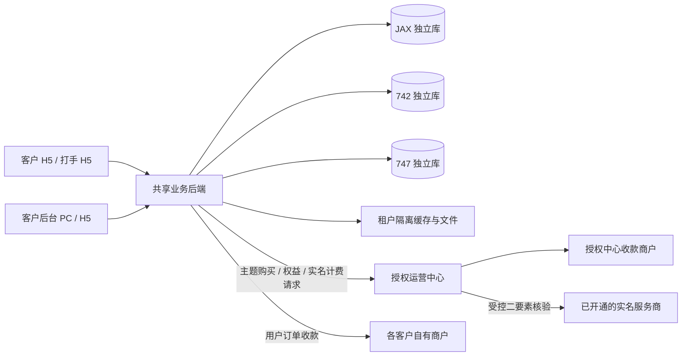

# Delta 主题商店与运营功能全量实施方案

- 文档版本：1.5
- 日期：2026-11-12（Asia/Shanghai）
- 状态：主题商店的客户端与授权中心商品基础已分别落地，正在补充真实支付和权益同步验收；协同打单已完成多人满员、分成总额、独立开关和退款舍入冲正的首轮后端修正；其余账号、实名计费、会员、营销和榜单能力仍按本文分批实施。尚未发布或启用生产功能。
- 范围：客户前台 H5、打手 H5、管理后台 PC `/`、管理后台 H5 `/h5`、授权运营中心。
- 用户最新要求：**本批所有工作与小程序无关，不安排小程序功能、配置、验收、构建或发布。** `delta-mp` 是现有 H5 源码所在目录，本文引用该目录只代表网页端。
- 依据：已阅读 [VIBE_CODING.md](VIBE_CODING.md) v2026-11-11.18、[development-conventions.md](development-conventions.md)、[客户实例与授权中心关系.md](客户实例与授权中心关系.md)、[项目结构说明.md](项目结构说明.md) 及多租户执行、进度和 W1–W9 记录；并核对主仓库与授权中心相关实际代码。
- 本次没有访问生产业务数据、调用收费实名接口、调整生产配置或部署客户端。下面的新增文件、表、接口名称中，首轮主题部分已经落地，其余仍是设计建议。

### 功能状态总览

| 序号 | 功能 | 当前状态 | 已完成 | 下一步 |
| --- | --- | --- | --- | --- |
| 1 | 主题商店与拟态主题 | 进行中 | 客户端主题权益、后台商店、网页主题应用、授权中心草稿商品已实现 | 运营设价并上架，验证真实支付回调、权益同步和到期回退 |
| 2 | 打手协同打单 | 进行中 | 已修正多人未满开始、提前组队完成、邀请分成超额、退款舍入；新增协同打单开关和 5 项回归测试 | 继续实现成员确认快照、换人后账务复核和后台协作页 |
| 3 | 网页微信/手机/密码登录 | 设计完成，未实施 | 已梳理现有登录方式和旧账号关联边界 | 实现公众号网页登录、主登录策略和补全会话 |
| 4 | 二要素实名与按次计费 | 设计完成，未实施 | 已完成服务商、接口、幂等、余额和隐私方案 | 实现授权中心计量账户、适配器和客户补全流程 |
| 5 | 用户会员等级 | 设计完成，未实施 | 已确定按有效消费成长、退款冲减和开关规则 | 新增会员数据模型、计价权益和后台配置 |
| 6 | 优惠券与邀请奖励 | 设计完成，未实施 | 已确定领券、占用、核销、退款和单层邀请规则 | 新增营销模块、发券幂等和奖励账本 |
| 7 | 消费排行 | 设计完成，未实施 | 已确定按订单净实收、退款修正和隐私退出规则 | 新增消费投影、周期聚合和公开接口 |
| 8 | 最近购买动态 | 设计完成，未实施 | 已确定真实订单、脱敏展示和撤回规则 | 新增展示投影、同意记录和前端组件 |
| 9 | 全功能后台开关 | 基础已具备 | 已有功能权益、本地启用、路由权限和系统配置能力 | 为新增功能补齐逐项开关、依赖校验和关闭后的存量处理 |

## 实现进度（首轮，2026-11-12）

客户端分支：`codex/theme-store-neumorphism`（提交 `54a39e5`）。授权中心分支：`codex/theme-store-authority`（提交 `ed976ef`）。本轮只做网页端与授权权益控制，不包含小程序。

已落地：

- 功能目录新增付费模块 `theme_neumorphism`，授权中心可沿用现有模块、订单和权益链路销售；授权失效时客户端公开主题接口回退 `default`。
- 新增管理员主题接口 `GET /admin/platform/themes`、`PUT /admin/platform/themes/active`，启用付费主题必须通过 `PlatformService.requireFeature`，不能只改数据库或前端样式。
- 新增公开主题描述接口 `GET /system/config/theme`，仅返回主题 ID 和版本；按请求域名校验功能权益，不返回价格、授权期限或凭据。
- 管理后台新增“功能与更新 → 主题商店”，包含经典清爽/柔光拟态预览、购买、启用与授权状态说明；路由和 `system.manage` 权限已接入。
- 客户 H5 与管理后台网页在启动时读取有效主题；默认主题和拟态主题均保留原业务布局、入口与返回逻辑。
- 新增首套柔光拟态样式：浅灰表面、轻阴影、清晰主色按钮；输入框、卡片、底部导航、表格和加载遮罩有对应适配。
- 后台与 H5 主题样式只在网页端加载；本轮没有修改小程序页面、配置、构建或验收。
- 授权中心新增 `theme_neumorphism` 草稿商品，默认价格为 null、周期 365 天、最低版本 1.15.0；运营人员在后台设置价格并改为 ACTIVE 后才进入客户端商品目录。

本轮实际验证：

- 后端全量 334 项测试通过，0 failures / 0 errors；其中新增 5 项主题权限与公开接口测试。
- 管理后台 Node 测试通过，生产构建通过；主题商店页面和拟态样式进入 `dist`。
- H5 Node 测试 87 项通过，`build:h5` 通过；拟态样式与主题读取逻辑进入 H5 产物。
- 后台和 H5 静态引用检查通过，缺失引用均为 0。
- 授权中心 57 项 Node 测试通过，生产构建通过；新增测试覆盖草稿商品、未定价禁止上架和上架后的客户端目录。

尚未完成，不能误报为已上线：

- 授权中心已有草稿商品，但尚未设置正式售价和改为 ACTIVE；目录中的 `priceCents=0` 只是客户端占位，实际收款金额以授权中心订单为准。
- `minVersion` 暂按 `1.15.0` 设计，当前 1.13.0 发布线不应对客户开放此付费主题；正式发布前再按实际版本调整。
- 主题购买后的真实微信支付回调、权益同步、到期回退和生产三租户验收仍需在授权中心测试环境和隔离客户环境完成。
- 其余账号登录、二要素计费、会员、优惠券、邀请、消费排行和购买动态仍按本文后续阶段实施；协同打单已进入第二轮修正，见下节。

### 协同打单首轮修正（第二轮，2026-11-12）

分支：`codex/order-cooperation`（提交 `d3c8df4`、`b7530aa`、`64749b8`）。本轮只修正现有协同打单的安全边界，不新增数据库字段，不改变一对一订单和接力结算的既有路径。

- 主打手开始服务前，后端核对已接受的队友数量；未达到商品要求人数时拒绝开始，并提示还缺几名队友。
- 队友接受邀请后，只有达到要求人数才把订单置回 `ACCEPTED` 并发送组队完成通知；未满员时保持 `WAITING_TEAMMATE`，避免用户提前看到“组队完成”。
- 邀请队友时，按当前抽佣和结算公式预估已接受/待接受队友及接力参与者的分成总额；超过可结算打手收益时在邀请阶段拒绝，不能等到订单完成结算才报错。
- 新增 `order.cooperation.enabled` 本地开关，默认开启；关闭后仅拒绝新的队友邀请，已确认队伍仍可继续履约、退款和结算。
- 退款冲正改为按参与人累计分配，确保小额退款的分币余数只分配一次，队友退款回收总额与订单级玩家退款一致。
- 新增五项回归测试：三人队伍逐个接受、未满员禁止开始、固定分成累计超额禁止邀请、关闭协同后已有队伍仍可开始、精确结算的小额多人退款舍入。

本轮验证：后端全量 334 项测试通过，0 failures / 0 errors。该数字来自协同分支基线，不包含独立主题分支的 5 项主题测试。

仍未完成：分成分配版本号和成员确认快照、同时多个待接受邀请、队友个人进度确认、换人后的账务复核、后台协作异常页、真实三端多人履约和退款验收。当前仍只允许同一订单保留一个待接受邀请，多人订单需要逐个邀请；这是尚未改动的现有交互限制。通用退款冲正已经由 `SettlementRecoveryService` 覆盖，本轮补的是多人精确结算下的舍入边界，不应再重复实现一套退款逻辑。

## 1. 总体结论

继续沿用 **一套核心代码、共享服务组、每客户独立数据库、独立配置和权益**。本批在模块化单体内增加能力，不按客户复制代码，不为每个功能新开一个 Java 服务，不引入新的常驻消息中间件。

将需求整理为四组：

1. 商业能力：主题商店、拟态主题、授权购买、实名用量账户。
2. 账号能力：网页微信登录、手机登录优先策略、密码辅助、实名与手机号补全流程。
3. 交易能力：协同打单、用户会员、优惠券、邀请奖励、统一计价与退款冲正。
4. 展示能力：消费排行、真实购买动态、按客户独立开关与页面适配。

主题和实名服务向**客户运营者**收费；用户的订单、充值和押金仍由该客户自己的支付配置收款。本期不向终端用户另收实名费。



正常商品、订单、聊天、会员和营销查询不经过授权中心。只有新实名核验同步依赖中心的专用服务；中心不可用时，已有认证状态、有效主题许可和普通业务不应全部不可用。

## 2. 实际代码基础与缺口

主仓库本次检查为 `codex/mp-weixin-742-fix`，HEAD `81e1135`，已有未提交改动。正式版本文件仍为 1.13.0。本方案保留这些既有工作，不将其当成本批功能实现。

| 用户需求 | 当前源码事实 | 本批处理 |
| --- | --- | --- |
| 主题商店 | `FeatureMarket.vue`、`PlatformService` 和授权中心已有模块购买/权益链路；未发现完整主题商品、主题引擎和主题启用记录 | 扩展现有商城，新增主题类型和渲染规范 |
| 打手协同打单 | `PlayerOrderController` 已有邀请、接受/拒绝、名额与状态检查；`order_player` 有角色、分成和结算字段；已有邀请页面、超时任务、接力与结算测试 | 补齐产品规则、分成确认、后台操作、完整状态与财务一致性，不重写另一套订单 |
| 微信/手机号/密码登录策略 | H5 已有短信、密码、设密/重置；公众号接口主要是登录后的通知绑定；没有所需的网页登录与统一补全策略 | 新增公众号网页登录及策略中心；保留现有手机账号 |
| 自动二要素实名 | `IdentityVerificationController` 当前为证件照片上传、姓名/号码格式检查、人工审核；`identity_verification` 不是权威核验服务 | 保留人工审核，新增授权中心代理核验与独立计量账本 |
| 会员等级 | 当前有 `player_level`，作用是打手等级和报价；不是购买用户的会员体系 | 建立独立用户会员模型 |
| 优惠券/邀请奖励 | 未发现完整发券、占券、核销、奖励账本；现有队友邀请/打手入驻邀请不能等同用户拉新奖励 | 新增营销领域，复用现有订单支付退款事件 |
| 消费排行/购买动态 | 有统计看板、订单查询和业务事件；未发现符合本需求的公开排行与脱敏动态链路 | 新建受控聚合与公开展示接口 |
| 所有功能可开关 | 已有授权权益、本地启用、路由 `meta.feature`、`sys_config`；新功能尚未接入 | 统一功能决策、配置、权限与异常提示 |

### 2.1 已发现、需要纳入实施的具体问题

- 现有协同分成支持平分、四六、三七、自定义金额，结算最终会检查分成总额；多队友比例之和需要提前到邀请/确认时验证，不能等完成后才报错。
- `acceptInvite` 中一位队友接受后就可能发出“队伍已就绪”提示。多人订单应按实际最低人数统一判断，不能把一人接受直接当成全队准备完成。
- 现有订单价格只有商品价与打手加价，`OrderPricingService` 尚无用户会员/券上下文；新增优惠必须改服务端报价、订单金额快照、支付和退款，不能只改页面显示价格。
- `user.openid` 同时用于历史手机账号标记及关联打手，不能为公众号登录直接覆盖，避免打手身份与旧订单失联。
- 新实名流程会使授权中心临时处理姓名和证件号码，超出原有“纯授权元数据”职责；必须作为限定服务边界记录，不能因此把用户表和业务订单复制到中心。
- 授权中心本地 `package.json` 为 0.6.8，文档记载的生产为 0.7.0，本地 `main` 还有在线客服等大量未提交改动。**开发前必须找到并对齐实际发布提交及共享签名发布能力**，不能用当前目录直接覆盖生产。
- 多租户历史文档中仍有“待启用”等过时段落；本期采用已落地的共享组发布模式，正式上线前重新核验实际状态。历史成功记录不代替本期验证。

## 3. 统一产品规则与开关

### 3.1 功能生效模型

新业务生效条件：`代码支持 + 数据结构就绪 + 有效权益（收费功能） + 客户本地启用 + 必要配置完整 + 当前身份权限`。

权益决定能否使用收费能力；客户后台开关决定是否对本客户启用；员工权限决定谁能配置与操作。配置不是部署版本，同一共享组不能让三个客户运行三个后端版本。

后端统一提供能力结果：`supported / entitled / enabled / configured / available / reasonCode / configRevision`。站点公开接口只给展示需要的字段；价格成本、凭据、实名余额和内部拒绝详情只对授权管理员可见。

| 能力/建议配置键 | 新增默认值或迁移规则 | 关闭之后 |
| --- | --- | --- |
| `theme.enabled`、`theme.active_id` | 使用原默认主题；付费主题未启用 | 回到默认主题，保留主题配置和购买记录 |
| `order.cooperation.enabled` | 老客户保留原协作能力；不能升级时突然关掉 | 不承接新协作业务；在途多人订单允许受控补齐/换人，已确认队伍继续履约、退款、结算 |
| `auth.primary_method` | 老客户保留原手机登录；可选 `PHONE` / `WECHAT` | 改变主入口，不删除账号或密码 |
| `auth.wechat.enabled` | false | 停止新微信登录，保留手机登录和已有账号 |
| `auth.phone.enabled`、`auth.password.enabled` | 保留当前可用方法；密码定位为辅助 | 保存前检查至少一种当前网页环境可用的登录与恢复方式 |
| `identity.auto.enabled`、`identity.prompt_mode` | false / `OFF` | 不创建新付费核验；既有请求继续查结果、计费对账 |
| `identity.required_actions` | 空集合 | 改变新业务门槛；不截断退款、客服求助、隐私撤回等必要路径 |
| `account.phone_bind_mode` | 保留原规则；可选提醒/指定操作前必绑 | 不删除已绑定手机号 |
| `membership.enabled` | false | 不对新订单应用会员权益；已下单权益和历史等级记录保留 |
| `marketing.coupon.issue_enabled` | false | 停止领券/发券；已发出的有效券按原约定继续可用 |
| `marketing.coupon.redeem_enabled` | 已发券后默认 true | 是紧急停用开关，须提示受影响券与处理办法，不等同停止活动 |
| `marketing.invite.enabled` | false | 停止新归因/新活动参与；已满足资格的待发奖励继续履约 |
| `display.spend_rank.enabled` | false | 隐藏页面与公共接口数据，清理展示缓存；基础财务继续记录 |
| `display.purchase_feed.enabled` | false | 停止展示与发布新动态，保留受控审计，不影响订单 |

所有总开关和必要子开关都可在后台设置。允许一键关闭新增展示，但不可用“关功能”删除交易义务、停支付回调或清空账本。

新功能先全关闭、逐租户启用；**已有登录、已购人工实名和原协作功能的行为按旧配置迁移**，不把旧基础功能重新变成需要购买的项目。

### 3.2 配置保存要求

- 使用结构化表单、中文说明、前后端共同校验、乐观版本号和审计记录。
- 开启需要付费/依赖的能力时，显示“未购买、余额不足、配置不全、版本不支持”等具体原因。
- 不允许“实名强制 + 实名未开通/无额度”“微信唯一入口 + 公众号未配置”等无路可走的配置组合。
- 配置缓存以租户及修订号隔离；发布/关闭时失效。访问业务接口仍由后端检查，不靠旧前端缓存放行。
- 沿用 `utf8mb4` 与 UTF-8 写入规则，避免再次发生中文双重编码；不通过未声明字符集的 SQL 管道写中文配置。

## 4. 主题商店与第一套拟态主题

### 4.1 购买与启用

入口：客户后台“功能与更新 → 主题商店”，含全部主题、预览、已购买、购买记录、当前主题和恢复默认。

流程：`查看主题 → 查看兼容范围/到期规则/报价 → 授权中心创建订单 → 中心商户收款 → 验签回调确认 → 下发主题权益 → 客户后台同步 → 客户主动启用`。

推荐首期沿用现有按实例、按有效期销售的权益模型：免费默认主题 + 付费 `theme_neumorphism`。价格和周期由授权中心设置；具体售价由运营上架时确定。不要擅自承诺永久授权：现有订单预览会考虑项目维护期，必须在付款前展示实际授权截止时间和续费规则。

主题目录记录 `themeId / themeVersion / name / previewAssets / supportedSurfaces / minVersion / tokenSchemaVersion`。支付订单冻结名称、价格、周期和授权范围，不能以后用改价覆盖已付订单。

第一套建议做“柔光拟态”完整套装：

| 页面端 | 覆盖范围 |
| --- | --- |
| 客户 H5 | 首页、分类、商品、登录补全、下单支付、订单、会员/优惠券/邀请、排行、我的、聊天及异常页 |
| 打手 H5 | 大厅、工作台、订单、队伍、邀请、进度、收益、提现、资料与异常页 |
| 后台 PC/H5 | 同一主题的颜色、圆角、卡片、按钮和表单；保留各自导航、信息密度与布局 |
| 授权中心 | 提供主题管理、报价和销售记录，本期不改运营台自身皮肤 |

商店可按端预览；客户可以分别选择前台/打手端和后台使用默认或已购主题，但不改变角色入口。

### 4.2 视觉与技术实现

- 浅灰底、浅色面板、轻微内外阴影、深色可读文字、清晰主色按钮；金额、错误、禁用、焦点状态有明确识别。
- 拟态主要用于卡片、按钮和开关；表格、长列表、财务与支付确认区域优先清晰，不叠加厚重阴影。
- 使用统一设计变量：背景、表面、文本、主色、边框、阴影、圆角、间距、动画；先抽取硬编码样式再接主题。
- PC 手机宽度仍为紧凑电脑版；`/h5` 保留独立移动壳和返回逻辑；不因购买主题重新合并两套布局。
- 首版主题随受审查的正式静态制品交付，中心只分发目录和权益；不允许客户上传 JavaScript、任意 HTML 或任意远程 CSS 执行。
- 预览用合成数据和隔离样式，不改变全站主题、不展示其他客户截图。
- 主题加载失败、授权失效、版本不兼容时回默认样式；不得让支付、登录和订单页白屏。保留失效主题设置，恢复许可后由管理员选择重启。
- 缓存键含域名/租户、配置修订和主题版本；页面先有可用基础样式，再应用主题，避免长时间空白或明显闪烁。
- 首次渲染只加载当前主题；动画支持减少动态效果，控制阴影重绘开销，保留品牌 Logo 与工作人员头像回退规则。

主题退款属于授权中心商业订单售后，撤销对应权益并回默认主题；不触发客户业务订单退款，也不删除站点内容。

## 5. 打手协同打单

### 5.1 业务边界

首版仅同客户内部协作：一个订单、一名主打手、多名队友、一套支付与退款事实。不会创建多个可重复收款子订单，也不跨 JAX/742/747 共享打手。

商品配置是否支持协作、最低人数、最大人数；人数范围设受控上限，默认单人，原多人商品按旧值迁移。客户只支付一次，后台可以看全队及分配情况。

主打手负责邀请、启动和提交最终完成；队友可以接受/拒绝邀请、查看必要订单信息、提交进度与本人服务完成状态。客服管理换人与异常，财务权限人员处理分成争议；队友不能修改订单价格、退款或任意成员收益。

### 5.2 状态与页面

```text
订单已接单 → 组队中 → 达到最低人数且成员确认分成 → 服务中
            └→ 邀请拒绝/过期 → 释放名额 → 继续组队
服务中 → 各成员提交进度 → 主打手提交完成 → 用户确认 → 待结算 → 可提现
异常分支：撤销邀请 / 换人 / 接力 / 投诉 / 部分退款 / 全额退款
```

新增订单详情“协作队伍”区，统一显示邀请状态、到期时间、职责、分成预估及确认版本。后台订单详情显示完整操作记录；用户只看到服务人员、进度，不公开内部抽佣与队友收入。

接受邀请不等于全队就绪。开始服务统一核对最低人数、所有相关确认、打手状态和接单配额。

### 5.3 分成和并发

- 收益池从订单价格快照计算；先扣客户平台抽佣，队伍在打手收益池内分配。会员与券的影响必须在邀请确认时可见。
- 多人使用“人数均分 / 全员比例 / 固定金额 + 剩余给主打手”三种明确模型。旧五五/四六/三七仅作为两人模板兼容，不逐个队友套用完整收益池比例。
- 分配总额不得超过收益池，金额精确到分。均分尾差给主打手；退款按原快照比例冲减，最后一笔分配余数，保证总额守恒。
- 每次报价有 `allocationVersion`；邀请与接受绑定版本。变更已确认成员收益须重新确认；已结算不能直接改金额，用冲正/补发流水并审批。
- 锁定顺序统一为订单 → 参与关系 → 按 ID 排序的相关账户；事务内同时验证名额、重复邀请、状态、额度和分配总额。
- 成员退出/被替换保留历史工作量与接力记录，不能删除 `order_player` 来消除其已产生收益。
- 在途订单关闭功能后继续履约；尚未组满的已付多人订单允许经客服授权补齐/换人，不能统一禁止邀请使订单卡死。无对应履约义务的待确认邀请可取消并通知；无法正常完成的按既定售后流程处理。
- 聊天首期复用现有私聊与订单进度面板；完整订单群聊不列为本期隐含承诺，避免未经设计放开客户联系方式。

重点改造：将 `PlayerOrderController` 的协作事务逐步提取到 `OrderCooperationService`，统一使用当前结算、待结算冻结和退款恢复服务，禁止新增独立直接加钱包余额的分支。

## 6. 网页微信登录、实名与手机号补全

### 6.1 后台“账号与登录”配置

配置内容：主登录方式、手机验证码登录、密码辅助入口、公众号网页登录 AppID/Secret/回调地址、登录后实名策略、提醒触发来源（微信首次登录/所有首次登录）、实名后绑手机策略、需要完成认证的业务动作、隐私说明版本。弹窗触发来源和业务强制门槛分开，不能通过改用密码登录绕过实名下单要求。

此处是**后台配置客户用户如何登录**，不意味着游客微信身份可以进入管理员后台。管理端与客服端继续保持独立账号、Token 和权限，本期不默认新增员工微信免密登录。

登录、公众号通知和微信支付是三个独立能力。可以引用同一已登记公众号凭据，但开关、用途、回调 state 和权限独立；不得用“是否开启支付”决定能否微信登录，也不得自动把所有公众号通知绑定关系当成登录账号。

| 网页环境 | 微信优先时 | 手机优先时 |
| --- | --- | --- |
| 微信内 H5 | 公众号网页授权主按钮；取消后可用手机/密码 | 手机验证码为主，微信为次入口 |
| Safari、Chrome、Android 浏览器、QQ 内网页 | 手机为可用主入口；展示“在微信中打开”引导；不循环跳微信 OAuth | 手机为主、密码为辅 |
| 电脑浏览器访问客户前台 | 同上；具备网站应用资质时可选微信扫码登录 | 手机为主、密码为辅 |

网站扫码登录是另一个接入能力，不能假设公众号 AppID 就能直接支持；首版不以扫码资质作为交付前提。

### 6.2 登录后连续流程

```text
用户同意必要协议 → 微信验证或手机验证 → 创建短期补全会话
  → 按后台策略判断实名：无需 / 提醒 / 指定操作前必须
  → 用户单独同意实名处理 → 二要素核验 → 已通过
  → 按策略提示绑定手机号 → 验证短信 → 安全绑定或关联原账号
  → 可选设置密码 → 完成 → 返回登录前的同租户页面
```

- “主手机号登录”时手机号已验证，后续不重复弹绑定；“主微信登录”按用户要求先实名，再绑手机号。
- 当前 H5 首次手机号登录有强制设密流程；本批网页新流程改为可选设置密码，符合“密码辅助”的定位。原账号密码和重置能力保留，短信验证成功不等于可以跳过实名/手机之外的业务门槛。
- 页面由后端返回 `nextAction`、当前完成状态及可跳过项，不让几个页面各自判断并反复弹窗。
- 提醒模式可以稍后处理；强制模式可以浏览允许的公开内容，但创建订单等受限动作由服务端拦截。拒绝实名不会伪造认证成功。
- 新用户尚未补全时使用短期、最小权限的 onboarding 会话，不发可调用钱包/订单写接口的完整 Token。已登录老账号仍需在服务端检查新增动作门槛。
- 实名请求绑定补全会话的随机 subjectRef；手机号绑定完成后，在同租户内将结果安全关联到确定的用户 ID。不能只凭浏览器提交的 userId 归属认证。
- 返回、刷新、重新授权和断网后可恢复状态；完成过的步骤不再重复扣费或要求重填。返回地址限同租户内部路径，禁开放重定向与 URL 携带 JWT。
- 若配置要求实名下单，游客下单也必须遵守；首版不支持匿名游客完成该强制链，开启时明确同步禁用新游客下单。旧游客查单、退款和客服入口仍可用。

### 6.3 账号关联与旧用户保护

- 新建 `user_identity`：同租户内按 `provider + app_id + subject_id` 唯一；公众号 OpenID 不能脱离 AppID 使用。
- 旧 `user.openid` 继续兼容，不因公众号授权直接覆盖。打手关联新增稳定 `user_id` 或受控映射，先核实再回填；不凭相同昵称合并。
- 只有有效授权过程返回的身份可用；客户端传来的 OpenID、UnionID、实名通过标记都不是可信凭据。
- 手机号已属于既有账号时，完成该手机号验证及必要的原账号核验后绑定微信到原账号；不新建第二个钱包、不自动合并资产。
- 已绑定另一微信、账号被封禁、实名冲突、疑似账号接管时进入受控找回流程，不靠覆盖数据库记录解决。
- 第一次微信登录不创建可交易的影子会员钱包；完成关联后沿用唯一账号。补全会话过期可以清理，已发生的核验计费记录保留对账引用。
- OAuth state 一次性、短时有效，绑定租户/入口/浏览器会话/用途；授权码只在后端兑换。登录用 state 不可用于通知绑定或支付。
- AppSecret 加密/受保护保存、保存后不回显；新配置字段必须加入现有脱敏规则和公共配置拒绝清单。凭据客户端按租户及配置修订缓存并及时淘汰。
- 密码登录必须已有有效绑定手机号与密码；登录/验证码/找回按租户、账号、IP 多维限流，注销和改密继续使会话失效。

## 7. 授权中心二要素接口与计费

### 7.1 自写接口的具体含义

自己实现：稳定 API、实例鉴权、额度、限流、请求幂等、服务商适配、结果标准化、计费、查询与对账。真实性由已开通的权威核验服务提供。

身份证长度/校验位算法只用于减少错误请求，不能证明姓名与号码真实匹配；二要素也不能证明当前操作人就是证件本人。首版不把二要素宣称为人脸活体核身或手机号实名核验。

已核对的开源与接口参考：

| 来源 | 可借鉴范围 | 采用建议 |
| --- | --- | --- |
| [TencentCloud Node.js SDK：FaceidClient](https://github.com/TencentCloud/tencentcloud-sdk-nodejs/blob/master/src/services/faceid/v20180301/faceid_client.ts) | 官方 `IdCardVerification` 调用与类型 | 与授权中心 Node.js 技术栈一致，建议首个适配器 |
| [腾讯云二要素 API](https://cloud.tencent.com/document/product/1007/33188) | 姓名/身份证号、结果码、请求号及收费结果分类 | 实施时逐码映射，不能用 HTTP 200 代替实名通过 |
| [阿里云 TypeScript SDK](https://github.com/aliyun/alibabacloud-typescript-sdk/blob/master/cloudauth-20190307/src/client.ts) 与 [二要素接入说明](https://help.aliyun.com/zh/id-verification/information-verification/developer-reference/vatsl9lfmbwe74iv) | `Id2MetaVerify`、权威比对与服务端签名 | 作为备选适配器；首版仅启用一个服务商，避免超时双重核验 |
| [WxJava](https://github.com/binarywang/WxJava) | 公众号后端能力与 OAuth 接入 | 与现有 Java 依赖核对后复用；不是二要素数据源 |

资料核对日期为 2026-11-12。SDK 开源不等于数据查询免费，也不等于具备转售/代调用许可；生产接入前核对服务商账号资质、受托核验使用范围、条款与实际单价。研发用 mock，不拿真实用户资料试第三方 GitHub“免费实名接口”。

### 7.2 收费对象与金额

建议 **每个授权实例一个服务余额账户，客户先充值，按有效核验扣费**，不与终端用户钱包或其他客户余额混用。

- 人工实名模块原权益继续有效；在线二要素作为单独计量能力 `identity_two_factor`，不把旧购买当成无限次核验。
- 第一版不额外强制收在线接口年费，是否配置开通费是中心运营定价项；每次核验单价、余额、用量和扣费原因在客户后台清晰显示。
- 金额以整数分保存；如商务需要小于一分的单次报价，另行采用明确的整数微单位账本和展示转换，禁止浮点累加。
- 中心充值订单走中心商户；不从客户系统 MySQL 的用户 wallet 扣除费用。
- 单次价格和收费规则在创建请求时冻结，结果回来后不按新报价重算。充值退款只退未使用、未冻结额度，进入中心售后流程。
- 设置单客户日消费上限、单用户日核验次数、异常失败率、余额预警，避免被刷接口消耗余额。

### 7.3 请求和资金状态分开

```text
核验状态：CREATED → PROCESSING → MATCH / MISMATCH / INVALID / ERROR / UNKNOWN
资金状态：NONE → RESERVED → CAPTURED 或 RELEASED
UNKNOWN → 查询/对账 → 明确结果；不可直接变成“认证失败”后重新扣费
```

| 情形 | 对客户扣费规则（建议首版） |
| --- | --- |
| 本地格式错误、无权限、额度不足、限流拒绝 | 不调用服务商，不扣费 |
| 确认一致 MATCH | 扣一次，签发可验证结果凭据 |
| 确认不一致 MISMATCH | 扣一次；提交前明示“不一致也按有效核验计费” |
| 服务商明确返回不计费错误/无记录 | 释放冻结，不通过实名；按当前适配器规则解释 |
| 网络超时、返回丢失、进程中断 | UNKNOWN，先查本请求；不盲目重发第三方收费调用 |
| 同一幂等请求重复提交/查结果 | 返回原状态，不再冻结或扣费 |
| 已通过且资料未变、仍符合本租户认证策略 | 使用本地状态，不重复收费 |

腾讯云当前文档将一致/不一致列为收费结果，并区分无效输入、库异常等不收费结果。以上是拟定的客户计费产品规则；最终服务商成本与客户报价分别记账，不能假设所有服务商相同。[收费分类依据](https://cloud.tencent.com/document/product/1007/33188)。

技术事务顺序：

1. 业务后端验证身份、同意记录、租户和本地幂等请求，持久化本地 requestId。
2. 中心验证请求签名与实例授权；短事务创建请求、锁额度并预留费用。唯一键约束 `(instance_id, idempotency_key)`；相同键不同请求摘要返回 409。
3. 提交事务后调用服务商，不在数据库事务里等待外网，不阻塞中心登录与授权上报。
4. 短事务保存结果、费用流水、冻结释放/扣减；凭据可以从已保存结果重新生成，避免“已扣费但结果永久丢失”。
5. 业务后端验证结果凭据中的实例、subjectRef、requestId、结果、用途和有效期后更新本租户记录。重复回调或查询均不重复扣费。

服务商未提供可靠查询/幂等能力时，UNKNOWN 请求进入待核对队列，不宣称端到端恰好一次。给出运营处理时限，例如 24 小时内核对；到期仍无法证实的先解冻、不授予实名通过，后续不擅自补扣客户，供应商可能产生的成本单独处理。补发核验须明确为新请求并重新征得操作确认，不能后台无限重试。

### 7.4 API 与鉴权边界

建议中心新增：

- `POST /api/client/identity/verifications`：创建核验，接收幂等键和受控资料。
- `GET /api/client/identity/verifications/{requestId}`：本实例查询结果，不含完整证件号码。
- `GET /api/client/usage/account`、`GET /api/client/usage/ledger`：余额及脱敏流水。
- `POST /api/client/usage/recharge-checkout`：创建中心充值收款订单。

实例签名许可证用于校验授权，但**许可证不是调用方私密身份凭据**。新增独立的服务端实例调用凭据，按 `keyId + timestamp + nonce + method + path/query + bodyDigest` 计算请求签名，中心核对实例映射、时间窗和重放；凭据只留在该租户后端受保护配置中，可轮换/吊销。不能把中心签发私钥交给客户后端。

公网浏览器不直连中心核验收费 API，不持有服务商密钥或实例调用密钥。用户即使伪造前端“已付费/已认证”，也不能越过中心账本与后端结果验签。

### 7.5 数据最小化与中断处理

- 客户库保存认证状态、来源（人工/二要素）、脱敏号码、租户专用 HMAC 指纹、同意版本、核验请求号和审计。人工通过不自动改成权威二要素通过。
- 中心只保存计费主体、随机 subjectRef、请求号、结果码、价格规则版本、金额、供应商请求号和必要时间。使用实例作用域摘要去重，不建立跨客户自然人身份库。
- 姓名/号码仅为本次核验经 TLS 短时处理，不写普通日志、追踪标签、URL、错误堆栈、订单备注或许可证。如果恢复机制确需临时持久化报文，使用隔离加密存储、最短 TTL 与销毁记录，不能进入普通业务表/备份长期保留。
- 二要素首版不收证件照片；现有人工实名照片继续按原私密清理规则处理。
- 提交前单独说明处理目的、必要性、中心/服务商接收方、费用规则和撤回路径。敏感信息处理的单独同意与必要性要求参见 [个人信息保护法](https://www.cac.gov.cn/2021-08/20/c_1631050028355286.htm)；生产开启前完成适用的个人信息保护影响评估和受托处理安排。
- 中心不可用/余额不足时，不能伪造通过；强制实名的新受限业务暂缓，浏览、已有订单售后、找回与客服求助保留。人工审核只有在租户策略明确允许且满足业务要求时才作为另一路径，并保留来源区别。
- 系统原有禁止收集/泄露客户业务数据规则继续有效。实施前只为上述限定的核验处理补充 VIBE 和中心规则说明，不扩大成业务数据汇聚。

## 8. 用户会员等级

推荐首版采用 **累计有效消费成长等级**，不是付费订阅会员，也不是打手等级。名称、阈值、图标、折扣和有效范围在每客户后台配置。

例如普通/白银/黄金/钻石只是可修改模板；不预设真实售价或替客户启用促销。会员可展示等级、升级进度、权益说明与成长明细。

统一口径：

- 以已完成并确认的业务订单实收计入有效消费；成功退款按实际退款额冲减。余额充值、押金、赠额、被取消订单、未支付订单及授权中心购买不计。
- 余额支付的真实本金在订单完成时计一次，充值时不提前计，避免重复成长；赠送金若未来上线须单独识别，不能当实际消费。
- 新功能默认从启用日期开始计算；老订单导入是独立受控批次，先预览差异、审批后幂等回填，不自动给历史用户大量发券或奖励。
- 成长流水按订单/退款事件唯一。退款可以触发等级回落，后台展示原因；人工指定等级必须有期限、理由和审计。
- 订单下单时冻结会员级别与优惠快照；后续升级/降级不反向修改旧订单价格。
- 关闭会员只停止新增权益使用，不影响既有订单。基础消费账本继续维护退款/更正；重新启用时按同一统计范围恢复，避免切开关清空进度。

首版权益：等级标识、会员折扣、指定会员券。优先派单、提现优先、付费会员卡等不混入本期基础等级，以免改变履约公平性及账务边界。

## 9. 优惠券与邀请奖励

### 9.1 优惠券

后台支持满减券、折扣券（最高减免上限）、适用商品/分类、有效期、发放总量、单人限领、会员门槛、主动领取、定向发放和批次记录。

首版一个订单最多一张券，可配置是否与会员折扣叠加；推荐允许“会员折扣后再减一张券”，后台同时展示成本预估。券只用于服务订单，不用于充值、押金、提现、主题和实名服务充值。

```text
AVAILABLE → LOCKED（下单占用）→ USED（支付确认）
LOCKED → AVAILABLE / EXPIRED（关单且确认无有效付款）
USED → 按退款规则恢复一次或保持已用，不伪造现金退款
```

库存扣减、用户限额与占用以数据库条件更新、唯一键和事务保证，Redis 只用于缓存/限流。相同发券批次重复执行不多发；并发两单不能花同一张券。

支付超时不能仅靠前端倒计时放券：先确认支付状态/关单，处理迟到 SUCCESS。券核销与支付入账用同一业务幂等依据，避免一张券支持两笔有效付款。

退款规则：首版全额退款且尚在券有效期内可以恢复一次；已过期显示已过期，不偷偷延长；部分退款不返券。累计退款不超过原实付，券面额不退现金。被领走的券模板不能物理删除或改写历史约定。

### 9.2 单层邀请奖励

首版推荐：邀请新用户完成绑定与第一笔符合门槛的订单，订单确认且售后观察期结束后，向邀请人发一张奖励券；被邀请人可领配置的新客券。暂不做可提现现金返佣和多级分销。

- 每租户独立邀请代码/链接；分享回流只保留安全归因字段和允许的内部路径。
- 以新账号首次有效登记确定唯一邀请人；一个被邀请人只归因一次，不覆盖旧会员、不奖励自邀、不允许循环关系。
- 记录活动版本、归因时间、有效窗口、首个合格订单、奖励条件和状态，不只靠浏览器 localStorage。
- 被邀请人的合格订单同时满足实付门槛、正常完成、无活动退款/投诉、风险检查；门槛按优惠后的实付计算。
- 退款发生在奖励发放前，取消/重新评估资格；奖励后未用券可撤销；奖励券已使用时进入风险/运营记录，不直接从用户余额强扣。
- 每日奖励数量、活动总预算、手机号/账号/设备等合理风控综合判断；共享 IP 不作为唯一拒绝依据。设备信息收集遵守最小化。
- 后台展示有效邀请数、待发/已发/取消奖励与异常处理，不暴露完整好友手机号。

### 9.3 唯一计价顺序及示例

扩展现有 `OrderPricingService`，按“商品原价 + 打手加价 → 会员折扣 → 单张券 → 应付金额”计算。前端只提交商品/券选择与报价版本，金额以服务端重算为准。

建议保留现有 `order.amount` 语义为最终应付/支付核对金额，新增原价、会员减免、券减免、定价版本和权益来源快照；不要让支付、退款和结算各理解一个不同的 amount。

示例仅用于设计：商品 100 元、打手加价 20 元，会员 95 折后 114 元，再减 10 元券，实付 104 元。抽佣 20% 为 20.80 元，打手池 83.20 元，两人均分为 41.60 元/人；若客服从抽佣中分 20%，客服 4.16 元，平台剩余 16.64 元。合计仍为 104 元。

首版推荐按**优惠后实收**结算并提前展示给打手；客户承担促销导致的总收入下降。若要“优惠只减平台利润、打手保底不变”，必须另设补贴来源、预算和独立补贴账本，不能悄悄改变本期结算公式。

防止优惠超过应付、负数和小数误差；首版最低应付保持 0.01 元，零元订单需要独立支付终态设计，暂不开放。退款按原分配比例冲回平台/客服/队友，同时冲回成长、排行与奖励资格。

## 10. 消费排行与最近购买展示

### 10.1 消费排行

入口：客户 H5 首页可配置入口或卡片、独立榜单页；后台独立排行配置与统计页。

- 默认月榜，可配置周/月/总榜；时区统一 Asia/Shanghai，周期边界按该时区生成。
- 口径与会员有效消费共用：已完成订单净实收，成功退款扣减，排除充值、押金、赠额、测试/异常订单及游客影子账户。
- 建立按日消费事实与周期聚合；退款修正原订单所属周期，同时记录退款发生时间，避免历史月榜与本月账务混淆。
- 先更新聚合，再生成有限 Top N 快照；展示更新时间。并列按明确稳定规则排序，例如达到该净额的时间，再按内部稳定 ID，不能每次随机跳名次。
- 公开默认只展示主动允许展示的用户、脱敏昵称/允许的头像与名次，金额默认隐藏。用户可退出排行；后台财务统计仍完整但受权限保护。
- 不提供任意 userId 查询别人的累计消费；“我的排名”须登录且只能查本人。后台完整报表和公开榜单分接口。

### 10.2 最近购买记录

首页展示“玩家小＊购买了某某服务”一类轻量轮播。**只生成真实成功支付的业务订单，不随机编造名字、次数或成交记录。**

- 支付成功且用户允许展示后生成脱敏事件；原单成功退款/取消、商品不适合公开或用户撤回展示许可时撤下。
- 默认匿名昵称或脱敏展示；不展示真实姓名、证件、手机号、订单号、游戏账号、联系内容、付款金额和精确时间。
- 使用商品安全展示名称，过滤可能含敏感内容的自定义字段；点击只去商品页，不去他人订单详情。
- 配置显示位置、最多条数、时间窗口、滚动间隔、是否展示头像；建议只取最近 24 小时内最多 20 条，缺数据时隐藏。
- 关闭弹窗动态不停止付款；不在登录、实名、支付、售后页覆盖关键按钮。减少动态效果模式使用静态或无动画展示。
- 初次页面请求批量取数，前台可见时最多每 30–60 秒一次刷新，切后台暂停；不每轮播放都重新查数据库。
- 缓存和撤回处理必须按租户隔离；清理失效数据时还需更新 CDN/浏览器缓存策略，防止已撤下信息继续公开。

## 11. 后台菜单与页面清单

### 11.1 建议菜单

```text
功能与更新
  功能商城 / 主题商店 / 服务用量与充值 / 系统更新
用户与隐私
  用户列表 / 会员等级与权益 / 成长记录 / 实名记录 / 隐私申请
营销中心
  优惠券 / 发放批次 / 邀请活动 / 奖励记录
订单与售后
  订单列表（含协作队伍）/ 协作异常 / 退款与争议
内容与展示
  消费排行 / 最近购买动态 / 展示隐私设置
系统管理
  系统配置 / 账号与登录 / 功能开关 / 员工权限
```

系统配置保留基础参数，用分类卡片与二级分组组织；不把主题、营销规则、实名账单全部塞进一排横向页签。复杂功能使用专门页面，在系统配置只放开关、状态与快捷入口。

后台 PC 可展示筛选、表格与批量操作；手机打开 PC URL 保留紧凑 PC 导航；后台 H5 使用卡片、简化筛选和固定主操作区。涉及批量发券、充值、分账调整等操作有结果预览、明确按钮与服务端权限，不因手机布局省略关键确认信息。

### 11.2 必须实现并逐项验收的页面族

| 端 | 页面/改动 | 关键验收 |
| --- | --- | --- |
| 客户 H5 | 登录、微信回调、账号补全、实名结果、绑定手机、密码辅助 | 返回原页、刷新恢复、取消授权、账号冲突、已实名不重复扣费 |
| 客户 H5 | 会员中心/权益/成长、我的券/领券、邀请/奖励 | 资格、分页、空态、到期、关闭入口、退款更正 |
| 客户 H5 | 商品、下单报价、支付、订单详情、退款、我的 | 折扣展示与实付一致，队伍信息只展示允许字段 |
| 客户 H5 | 首页动态、消费榜、展示隐私 | 租户隔离、撤回、隐藏金额、减少动画、点击商品 |
| 打手 H5 | 邀请列表/发起、订单队伍、分配确认、进度、收益明细 | 多人并发、版本冲突、名额、替换接力、退款冲正 |
| 后台 PC + `/h5` | 主题商店/预览/已购、用量充值/明细、账号策略、功能开关 | 权益与员工权限叠加，保存校验、回跳、无密钥回显 |
| 后台 PC + `/h5` | 会员规则、券模板/批次、邀请活动/记录、榜单/动态管理 | 数据筛选、幂等批量操作、审计、已生效规则版本化 |
| 后台 PC + `/h5` | 订单协作详情、争议处理、原人工实名页兼容 | 历史单保持、分账权限、无越权资料、关闭后继续履约 |
| 授权中心 | 主题商品、主题订单/权益、实名服务定价、账户充值、用量与对账、异常请求 | 错金额/重复回调拒绝或幂等、按实例隔离、凭据轮换与吊销 |

权限建议细分：`theme.manage`、`identity.config`、`identity.review`、`service.billing`、`membership.manage`、`coupon.manage`、`coupon.issue`、`invite.manage`、`cooperation.manage`、`display.manage`。兼容现有管理员角色，但不能默认给普通客服发券、充值或改变分账权限。

## 12. 代码组织、接口和数据模型

### 12.1 代码改动落点

以下路径相对 `D:/codeStudy/code/cangshuo-detla`；授权中心相对独立仓库。

| 领域 | 现有入口 | 拟定改造 |
| --- | --- | --- |
| 功能与主题 | `delta-admin/.../platform/PlatformService.java`、`PlatformController.java`、`platform/catalog.json` | 收费主题目录、能力查询；决策契约下沉，授权实现保留，避免下层依赖启动模块 |
| 主题前端 | `delta-admin-ui/src/styles/`、`src/views/platform/FeatureMarket.vue`；`delta-mp/store/site.js`、网页样式及组件 | 新增主题商店/预览、统一 token、网页主题解析与降级 |
| 账号 | `delta-user/.../controller/UserAuthController.java`、`UserController.java`、`service/impl/UserServiceImpl.java`；公众号服务；`delta-common/.../config/SecurityConfig.java` | `WebLoginService`、`AccountOnboardingService`、身份绑定、补全会话与动作门禁 |
| 实名 | `delta-admin/.../controller/IdentityVerificationController.java` | 保留旧接口，事务/核验流程提取服务；新增受控中心客户端与结果验证 |
| 协作 | `delta-player/.../controller/PlayerOrderController.java`、`delta-order/.../entity/OrderPlayer.java`、`SettlementEventListener.java` | `OrderCooperationService`、分配快照、确认版本、结算冲正兼容 |
| 营销会员 | `OrderPricingService.java`、`OrderServiceImpl.java`、支付退款事件；会员目前无完整模块 | 新增 `delta-marketing` 业务模块：会员、券、邀请、消费投影；仍部署同一 JAR |
| 导航与 API | 管理端 router/layout/api/权限；H5 `pages.json`、`api/`、`store/`、角色页面 | 注册新网页、权限守卫、后台 H5 别名、统一返回、错误/加载状态 |
| 数据兼容 | `DatabaseCompatibility.java`、两处现有迁移目录、基础 SQL | 每批新增可重复迁移、结构就绪检查、索引与回退说明 |
| 授权中心 | `server/store.mjs`、`payments.mjs`、`management.mjs`、`http.mjs` | 拆出 `themes.mjs`、`usage-billing.mjs`、`identity-verification.mjs` 和 provider 适配器，补中心页面与测试 |

`delta-marketing` 不依赖 `delta-order` / `delta-user` / `delta-pay` 的实现类来互相调用；业务契约与事件放受控的通用接口，营销使用本域 Mapper/必要跨域查询，订单通过接口取优惠计算结果。启动模块负责装配。用依赖测试防止 Maven 循环依赖。

订单状态和 `domain_outbox` 在同一租户事务提交；成长、奖励、排行等投影按事件唯一键处理并可重放。不能仅使用内存 Spring 事件假定进程崩溃也一定送达。支付核销、额度冻结等实时一致性仍在对应数据库短事务内完成，不拖成最终一致以掩盖超卖。

### 12.2 租户数据库增量设计

| 表/扩展（拟定） | 用途 | 关键约束 |
| --- | --- | --- |
| `theme_setting` | 各端当前主题与 token 修订 | surface 唯一、主题/配置版本 |
| `user_identity` | 公众号等登录身份映射 | provider+app_id+subject 唯一；绑定确定 user_id |
| `account_onboarding` | 未完成注册/关联流程 | 随机 session 摘要、过期、单次消费；不存密码和完整证件 |
| 扩展 `identity_verification`；`identity_request` | 区分人工/二要素、每次核验状态 | 请求号唯一、同意版本、主体绑定、结果指纹 |
| `membership_level`、`user_membership`、`membership_growth_ledger` | 等级定义、当前等级、成长变化 | 用户唯一，业务事件唯一，人工覆盖有期限 |
| `coupon_template`、`coupon_issue_batch`、`user_coupon`、`coupon_usage` | 发券、占用、核销、返券 | 批次+用户+发放序号唯一；每券只有一个活动占用 |
| `invite_campaign`、`invite_relation`、`invite_reward` | 活动、唯一归因、奖励状态 | 本租户被邀请用户唯一，跨活动不重复认作新客；首单奖励幂等唯一 |
| `user_spend_ledger`、`user_spend_daily` | 可重建的有效消费事实与聚合 | 订单/退款事件唯一；用户+日期唯一 |
| `purchase_feed_event`、`user_display_preference` | 安全展示投影与同意/撤回 | 订单事件唯一、禁止原始敏感字段、过期与撤回索引 |
| `domain_outbox`、消费去重记录 | 事务后可靠事件处理 | event_id、aggregate_version、consumer 唯一 |
| 扩展 `order` / `order_finance_snapshot` | 原价、折扣、券与结算基数快照 | 不改变旧 amount 含义；`pricing_version` 区分新旧逻辑 |
| 扩展 `order_player`；`order_allocation_snapshot` | 分成确认与历史版本 | 订单+分配版本+成员唯一；保留替换历史 |

每客户独立库无需给所有业务表重新合库加 tenant_id；跨库的消息、缓存、审计与外部请求必须带可信租户标识。公共匿名接口也不能缺少 Host 租户解析。

### 12.3 授权中心增量设计

| 表/扩展（拟定） | 说明 |
| --- | --- |
| `theme_catalog` + modules 元数据 | 主题商品及兼容范围；主题权益复用现有 entitlements |
| `service_account` | 每实例独立充值余额、冻结额、状态、版本 |
| `service_price` | 服务、实例适用范围、单价、计费单位、规则版本与生效时间 |
| `service_recharge_order`、`service_ledger` | 充值订单及不可覆盖的收支/冻结/冲正流水 |
| `verification_request`、`verification_attempt` | 请求幂等、服务商调用事实、结果、费用映射；无原始证件 |
| `instance_api_credential` | 受保护调用凭据、keyId、权限范围、轮换与吊销 |

现有 `payments.mjs` 的订单查询与履约紧耦合 `modules/orders`，**不能把充值当成“买一个模块”就直接加余额**。应抽取支付收款公共层，按订单类型派发主题权益或服务充值；验证商户/AppID/订单/金额/币种/交易号，重复回调只能履约一次。

中心当前使用 SQLite，首期保留，但写事务要短、设置有界并发与繁忙处理，核验网络请求不能占写锁。运行压测若证实充值/扣费吞吐超预算，再单独迁移计费存储；本方案不凭空承诺 SQLite 的客户数上限，也不立即引入第二套重型数据库。

### 12.4 业务 API 分组（拟定）

| 分组 | 主要接口 | 边界 |
| --- | --- | --- |
| 公共网页配置 | `GET /system/config/site` 扩展能力与主题信息 | 白名单字段，按租户缓存 |
| 网页认证 | `/user/auth/web-policy`、`/user/auth/wechat/start`、`/user/auth/wechat/callback` | 只开放明确端点，不泛化放行 `/user/**` |
| 补全 | `/user/onboarding/status`、`/identity`、`/phone`、`/complete` | 仅受限会话与指定动作；身份校验不被前端跳步绕过 |
| 会员与券 | `/user/membership`、`/user/coupons`、`/user/invites` | 仅本人；批量发券为管理员独立接口 |
| 报价 | 现有订单报价扩展 | 服务端用户、券、价格版本；不相信客户端金额 |
| 协作 | 复用 `/player/order/{id}/...`，补确认/取消/分配版本 | 所属订单、参与资格、状态和权限全校验 |
| 展示 | `/app/spend-ranking`、`/app/purchase-feed` | 限定分页与白名单 DTO；不复用完整订单序列化 |
| 管理 | `/admin/themes`、`/admin/memberships`、`/admin/coupons`、`/admin/invite-campaigns` | 具体员工权限、审计、幂等批次与乐观版本 |

实际路径以现有接口冲突检查后固定；新增请求统一走前端 `api/`，页面不散落服务地址。

## 13. 性能、资源和安全要求

本批必须和 [全面技术优化方案](全面技术优化方案-2026-11-11.md) 衔接，先补资源和可靠性基础，不在已有紧张资源上增加无界后台任务。

- 授权与功能决策用按租户原子快照；正常请求不反复读取状态文件、不逐次访问中心。
- 列表分页、批量获取会员/队伍/优惠信息，避免每行查询一次；排行榜按事件聚合，不让首页全表 SUM 订单。
- 有限大小线程池、租户任务配额、任务超时、数据库连接预算；中心核验与业务支付使用独立并发额度，防止一个接口占满所有请求线程。
- 租户事件处理带上下文且 finally 清理；失败租户不阻塞其他客户。重试有退避、次数上限、待核对/死信状态。
- 不在 JVM 长期保存所有券/全量排名/全量用户；缓存有容量上限、TTL 和版本失效机制。
- 计价、券核销、服务余额、分账和退款使用数据库事务/条件更新/唯一约束，Redis 锁不能作为唯一正确性保证。
- 财务数据和同意记录使用专用 DTO；手机号/证件脱敏，日志禁记录实名请求正文、OAuth code、Secret、完整 Token。
- 主题、昵称、商品展示名和运营内容均需防 XSS；外部回调/供应商 endpoint 固定白名单，避免 SSRF 与开放重定向。
- 余额与实际费用、未决 UNKNOWN、券占用超时、outbox 积压、退款冲正失败、主题降级及 OAuth 失败都要有指标；标签不含用户身份信息。
- 备份必须覆盖新增账本、中心数据库与私钥/调用凭据，分租户恢复与对账；恢复旧库不能覆盖已确认的新交易。

建议在隔离环境设定对比门槛：同负载 p95 延迟退化不超过 10%、首页资源增量预算先固定、常驻内存无持续上涨、连接与队列不超过预算。具体绝对 QPS、内存和 RTO/RPO 由现有资源实测填入，不能用静态页面可打开代替容量验收。

## 14. 数据迁移、版本与安全更新

### 14.1 兼容升级

1. 先对齐两个仓库的可追溯基线，拆清现有未提交工作；在独立功能分支实施，不覆盖当前改动。
2. 新增表/可空列/安全默认列；维护基础 SQL、独立幂等迁移、`DatabaseCompatibility` 与真实 MySQL 测试。
3. 每租户记录迁移批次与校验和。先演练，再按维护计划扩展三库；未知/不就绪租户拒绝新功能，不回退到其他客户库。
4. 先发布兼容中心 API，再发布业务后端/后台/H5；后端保留旧客户端接口，新增配置缺失时保持旧行为。
5. 人工实名、已有手机账号、旧分账/退款按原版本快照继续；不把历史记录统一改成新收费、新优惠或新认证状态。
6. 新业务先在合成租户验收，生产共享组统一升级代码后，按单客户逐步开功能。若需要灰度不同二进制，另用服务组，不能同一 JVM 按开关假装不同版本。

当前更新执行器只接受 `schemaVersion=1`，不能让 ZIP 夹带任意 SQL 并自动执行。新增数据库迁移仍按仓库的受控兼容/运维流程执行，协议 schema 与每库结构迁移编号分开。若实际需要不兼容协议，按 MAJOR 规则另立版本，不擅自改 schema 绕过校验。

### 14.2 回退边界

- 尚未启用新功能且扩展结构兼容时，可回退上一程序，保留新增列/表。
- 已使用优惠券、计量实名或新分成后，不能假设 1.13.0 能理解新状态。优先关闭新入口、停止新发放，在能处理新交易快照的兼容版本上完成存量事务。
- 不能通过恢复升级前数据库撤销用户已付款订单，也不能删除中心计费账本“退回旧版”。先对账与前向修复，必要时设计专门的数据恢复。
- 单客户的主题或营销开关回退不回滚整个共享 MySQL，不清其他租户 Redis。
- 主题加载失败可直接回默认；认证计费异常先停新核验，保留结果查询和冻结处理；优惠异常先停新发券，保留存量券、支付与退款处理。

### 14.3 版本和发布安排

本方案不修改产品版本。新功能应使用 MINOR，不把整批新增能力塞入 1.13.1。

已有技术优化文档把 1.14.0 规划为性能与稳定性批次。建议优先完成该基础，再将本批完整业务能力排入后续 MINOR（暂以 **1.15.0 候选**描述）；这不是已占用/已发布版本，正式编号按届时实际主线决定，避免两份方案争用 1.14.0。

本期按用户要求，只安排后端、管理后台、H5 的版本、制品和验证；小程序不在交付中。若发布工具仍含历史多端版本门禁，应在发布设计中明确本期网页交付范围及必要的共用元数据处理，不以调整版本字段冒充小程序已适配/验收。

正式发布仍必须：干净提交 → 测试构建 → 版本说明 → 三个 ZIP → 静态引用与 UTF-8 解包校验 → SHA-256 → 不可变 Release → 授权中心更新项目录与共享签名计划 → 备份、维护窗口、健康检查与回退。

JAX/742/747 共用一个程序版本，客户能独立购买主题和启用功能，不能在自身后台重启/更新共享进程。独立部署客户仍保留最后自行点击安装的规则。本方案交付不等于批准新的生产发布、充值、扣费或为客户自动开启功能。

## 15. 实施顺序与交付门禁

| 阶段 | 交付 | 开始条件 | 完成证据 |
| --- | --- | --- | --- |
| S0 基线与契约 | 主线/中心源码对齐、开关/价格/状态/接口规范、增量表与权限设计 | 本方案进入开发 | 不覆盖未提交工作；接口与数据库设计评审记录 |
| S1 公共基础 | 能力决策、配置修订、短期补全会话、可靠事件、服务账本基础 | S0 | 租户隔离、幂等、并发额度与错误路径测试 |
| S2 主题闭环 | 主题目录/购买/权益/启用/回退、第一套拟态主题 | S1 | 全网页主题切换，中心购买链路，过期/故障回默认 |
| S3 账号与实名 | 网页微信登录、主入口、实名收费与补全、手机/密码辅助 | S1 | 旧账号不丢失，未补全不能越权，收费/UNKNOWN/恢复可对账 |
| S4 计价与协作 | 统一价格快照、团队分配与确认、旧订单兼容 | S1 | 多人并发、部分退款、接力、收益总额守恒 |
| S5 会员与营销 | 等级、券、单层邀请奖励与财务冲正 | S3/S4 | 同券不重复用、奖励不重复发、退款正确回冲 |
| S6 展示与联动 | 消费榜、购买动态、隐私控制、导航全链 | S5 | 全部新增页面与旧流程逐页矩阵通过 |
| S7 发布准备 | 全量回归、压测、迁移恢复演练、运营配置文档 | S2–S6 | 三客户独立验收、正式制品与授权更新项准备完整 |

可独立验证的阶段使用开发分支/隔离环境推进；不是每个小阶段都发布一次正式版本。先做主题并不跳过实名/营销的账务设计，后续模块按依赖接入。

运营待定项不阻挡结构研发：主题售价与周期、实名客户单价与上游合同、会员等级阈值、券预算、邀请奖励券与人数上限、是否允许已有人工实名满足指定动作、排行公开范围。开发使用明确默认/mock；真实收款、强制认证和批量发券前将这些值变成可审核配置，不擅自用示例数值上线。

## 16. 全量验收矩阵

页面清单以届时实际管理端 router 与 H5 注册页生成，包含新增页及依赖旧页，不沿用历史“435 页通过”作为本期证明。记录租户、角色、主题、端、路由、用例、结果及脱敏证据。

| 编号 | 验收内容 | 必须结果 |
| --- | --- | --- |
| A01 | JAX/742/747 相同用户/订单 ID、不同开关/主题 | 数据、品牌、许可、余额、缓存互不串用 |
| A02 | 伪造 Host、跨客户 Token、外部回跳、失效 OAuth state | 拒绝，不写入错误客户库 |
| A03 | 手机/微信优先、微信内/外网页、取消授权与过期 | 总有受控可用入口，不循环跳转，不错绑账号 |
| A04 | 老手机用户绑定微信、已绑定冲突、封禁、密码找回 | 不丢原钱包/打手关联、不自动合并余额、不账号接管 |
| A05 | 未实名/未绑手机直接调下单/游客接口 | 按策略拒绝；允许的浏览/售后路径仍可达 |
| A06 | 实名重复请求、同幂等键不同数据、超时、中心重启 | 不重复扣费，UNKNOWN 可核对，已付结果可恢复 |
| A07 | 两个核验争用最后一份额度、充值重复回调 | 无负余额、无重复入账；每实例独立 |
| A08 | 主题未购/到期/离线/加载失败/升级缓存 | 后端权益有效检查，默认主题可用，关键页不白屏 |
| A09 | 抢名额、重复邀请/确认、多人比例、退出接力 | 无超员，分成事先验证，历史参与和收益保留 |
| A10 | 会员折扣与券叠加、改价、超额优惠、重复支付 | 报价/实付/快照一致，无负价、无零元伪支付 |
| A11 | 两单抢同券、批量重复发券、超时迟到付款 | 不超发、同券不重复消费、不提早释放有效支付占用 |
| A12 | 部分/全额退款、优惠返还、成员结算、提现后退款 | 总额守恒、无多退、无重复冲正，使用现有资金追回规则 |
| A13 | 邀请自刷、老用户、重复首单、退款与奖励已使用 | 单层归因稳定、符合资格才奖励，异常不直接扣钱包 |
| A14 | 榜单跨月退款、金额隐藏、隐私退出、动态撤回 | 统计可对账、不泄露个人订单，不生成虚假动态 |
| A15 | 关闭功能、权益到期、中心断网 | 新业务按门禁停止，存量支付/退款/已承诺权益继续处理 |
| A16 | PC、手机宽 PC、后台 H5、客户/打手 H5 | PC/H5 布局区分、返回连续、加载/空态/错误一致 |
| A17 | iOS Safari、Android Chrome、微信/QQ 内浏览器 | 安全区、键盘、滚动、返回、OAuth与支付回跳实测；模拟与真机分开记 |
| A18 | XSS、SSRF、越权、重放、批量滥用、日志检查 | 无跨租户/敏感信息泄漏，金额和权限以后端为准 |
| A19 | MySQL 真实并发、迁移重复执行、中断恢复、旧版回退 | 可定位/可恢复，不覆盖已确认的新交易 |
| A20 | 新增负载、慢服务商、单客户突发、缓存失效 | 延迟/内存/连接/队列满足预先固定预算，其他客户可用 |

必须执行的验证类别：Java 17 后端全量与真实 MySQL 集成测试、管理端单测及生产构建、H5 单测及 `build:h5`、授权中心计费/支付/CSRF/隔离测试与构建、更新器相关回归、静态资源引用/MIME/ZIP 一致性、全页面浏览器验收、财务对账与恢复演练。**本期不以小程序测试作为交付项。**

实际对账增加：中心充值余额守恒/冻结守恒、核验请求与计费一一对应、券发放/占用/核销守恒、优惠快照与实付一致、会员成长与净消费一致、邀请奖励唯一、队伍分配与结算总额一致。旧“财务 12 项”继续跑，但不能覆盖这些新增账本就宣称全部财务已验收。

## 17. 交付与持续文档规则

本次交付是本方案与文档索引，不代表八项功能已经实现。没有执行新功能测试，不引用旧测试数量作为新功能通过证据。

后续每阶段更新：实际完成项、修改文件、接口/表变更、执行命令、失败与未验证项、版本/部署状态及证据链接。实施时补充目标模块 README 与自动测试，再同步 VIBE 的真实能力和有限实名服务边界；修改 VIBE 时按既有要求同时提升文档版号并同步各 AGENTS 读取回执。

所有源码、长期文档与构建产物放对应 D 盘项目目录；可控临时文件放 `D:/CodexData/temp/delta-feature-plan`，独立报告放 `D:/CodexData/outputs/delta-feature-plan`。任何报告不包含真实客户订单、身份证、完整手机号、密码、Token 或密钥。
