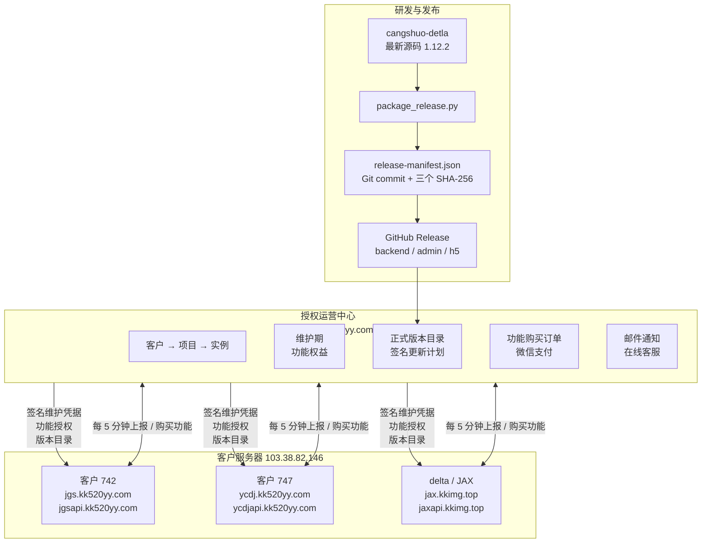
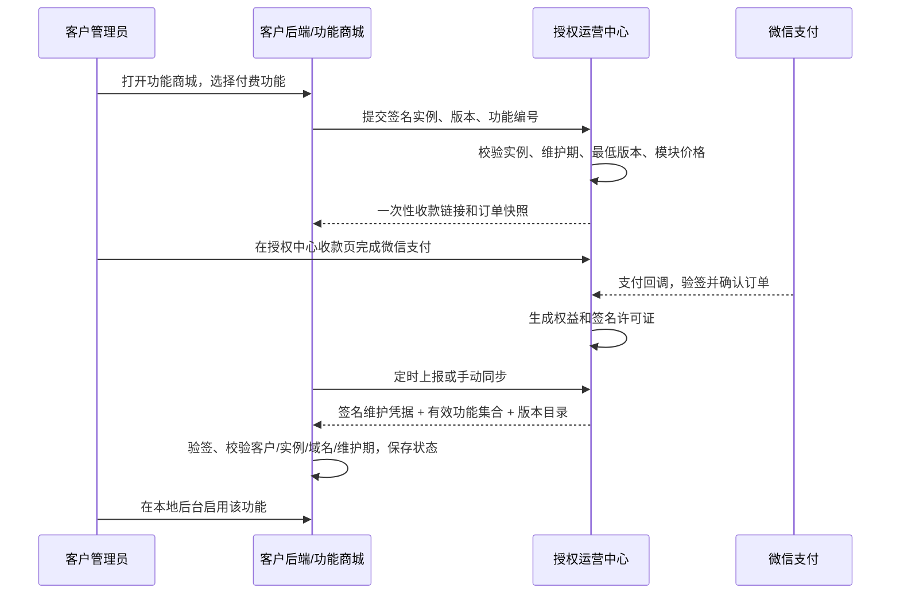
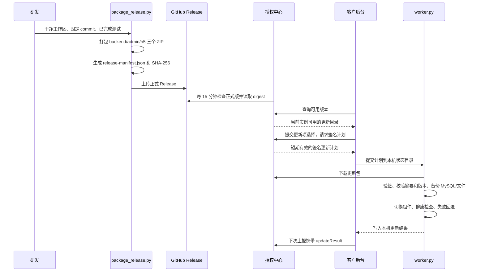

# 客户实例与授权中心关系

> 整理日期：2026-11-11。
> 生产版本和同步状态按 2026-11-11 的 JAX 生产验收及授权中心记录整理；本地客户目录只代表当时复制的代码，不等于生产实际版本。

## 1. 一句话关系

`cangshuo-detla` 是最新产品源码，三套客户系统是同一套代码的三个独立部署实例，不是一个数据库里的三个租户。`cangshuo-detla-authorize` 是独立授权运营中心，负责登记客户、项目、实例、维护期、付费功能、版本目录和更新计划，不保存客户的订单、用户、聊天和资金数据。

```text
最新源码（一套）
    ↓ 构建、打包、发布
GitHub Release（一套正式制品）
    ↓ 授权中心检查版本、计算可用更新
三个客户实例（三套数据库、Redis、文件、域名、授权）
    ↑ 定期上报版本、同步维护期和功能授权
授权运营中心（独立控制面）
```

## 2. 全景关系图



## 3. 授权中心的对象模型

授权中心使用“客户 → 项目 → 实例”的三层结构，软件和功能模块是另一条独立的产品线。

| 对象 | 含义 | 关键字段 |
| --- | --- | --- |
| 客户 Customer | 商务合作主体 | 客户编号、名称、状态、备注 |
| 项目 Project | 一个客户的一次运营项目 | 所属客户、软件、项目名称、维护期、暂停策略、通知邮箱、默认支付通道、定金/尾款 |
| 实例 Instance | 一套实际部署的客户系统 | UUID、所属项目、域名、客户端版本、最近上报时间、功能权益 |
| 软件 Product | 一套可发布的软件 | 软件编号、仓库、类型 |
| 功能模块 Module | 可单独售卖的付费能力 | 模块编号、价格、周期、最低客户端版本、所属软件 |
| 权益 Entitlement | 某个实例购买或获赠的模块 | 实例、模块、生效时间、到期时间、启用状态 |
| 授权 License | 授权中心对实例签发的凭据 | 客户、实例、维护期、允许域名、功能集合、签名 |
| 版本 Release | GitHub 正式版本目录 | 版本号、更新说明、组件、资产摘要、更新项 |

当前电竞业务软件编号是 `detla`，仓库指向 `zhz520/cangshuo-detla`。最新客户端目录包含六个功能：基础业务、收益对比分析、打手列表多布局、公众号模板通知、实名认证和邮件通知。

需要区分两个“启用”：

- 授权中心决定这个功能是否已经购买、是否在有效期内。
- 客户管理员在本地后台决定这个功能是否实际打开。

有授权但本地开关关闭时，功能不会出现在客户页面上；本地开关打开但没有有效授权时，功能入口会被隐藏或拒绝访问。

## 4. 三个客户实例对照

| 客户/项目 | 本地代码目录 | 本地目录版本 | 生产客户端版本 | 管理端域名 | 用户端域名 | 服务器部署 | 入口端口 |
| --- | --- | ---: | ---: | --- | --- | --- | --- |
| 742 | `code/742` | 1.2.0 | 1.11.2 | `jgsapi.kk520yy.com` | `jgs.kk520yy.com` | `/opt/apps/742` | 7420 / 7421 |
| 747 | `code/747` | 1.5.12 | 1.5.15 | `ycdjapi.kk520yy.com` | `ycdj.kk520yy.com` | `/opt/apps/747` | 7470 / 7471 |
| delta / JAX | `code/detla738` | 旧 master，未建立 catalog | 1.12.2 | `jaxapi.kkimg.top` | `jax.kkimg.top` | `/www/delta` | 8081 / 8082 |
| 授权中心 | `code/cangshuo-detla-authorize` | 0.6.8 | — | `auth.kk520yy.com` | — | 独立 Compose | 17441 |

“delta”与本地 `detla738` 的对应依据是：本地旧仓库的部署文档、短信模板、生产域名和 CORS 默认值都指向 `jax.kkimg.top` / `jaxapi.kkimg.top`，授权中心的生产同步记录则把第三个项目称为 `delta`。两处指向的是同一个客户站点。

生产版本说明：

- 742、delta、747 三个项目在授权中心均为“项目有效”；2026-11-11 JAX 已完成 1.12.0 生产更新和单租户共享服务组迁移。
- 747 的检查记录是 1.5.15，并且明确备注“需要客户自行升级后才能使用新版同步界面”。
- 本地 `742` 是 1.2.0，本地 `747` 是 1.5.12，本地 `detla738` 还是旧 master。三个本地目录都落后于生产，不能把本地 `package.json` 或 `catalog.json` 当成线上版本。
- 最新源码是 1.12.2。JAX 已于 2026-11-11 更新到 1.12.2；742 和 747 仍低于最新版本。升级应走正式 Release 和授权中心更新计划，不从旧客户目录重新构建覆盖线上。

## 5. 服务器部署关系

按现有部署资料，三套客户环境和授权中心都在同一台服务器 `103.38.82.146` 上，通过不同宿主机回环端口区分，再由 Nginx/宝塔按域名转发：

```text
Internet
  ├─ jgsapi.kk520yy.com  ──> 127.0.0.1:7420  ──> 742 管理后台
  ├─ jgs.kk520yy.com     ──> 127.0.0.1:7421  ──> 742 H5
  ├─ ycdjapi.kk520yy.com ──> 127.0.0.1:7470  ──> 747 管理后台
  ├─ ycdj.kk520yy.com    ──> 127.0.0.1:7471  ──> 747 H5
  ├─ jaxapi.kkimg.top    ──> 127.0.0.1:8081  ──> delta/JAX 管理后台
  ├─ jax.kkimg.top       ──> 127.0.0.1:8082  ──> delta/JAX H5
  └─ auth.kk520yy.com    ──> 127.0.0.1:17441 ──> 授权运营中心
```

仓库资料没有提供一次完整的生产 `docker ps` 或宝塔站点清单；上面的同机关系由 742、747 的部署文档和 738 的旧发布记录交叉确认，最终仍以生产主机实际容器和反代配置为准。

每套客户系统内部仍然是一个完整的 Compose 栈：

```text
管理后台容器 + H5 容器 + 后端容器
        │
        ├─ MySQL（客户独立数据库）
        ├─ Redis（客户独立实例/库）
        └─ uploads（客户独立上传目录）
```

三套系统之间不共享数据库、Redis、上传文件、管理员、订单、聊天或支付凭证。它们共享的是代码、数据库表结构、接口协议、功能目录和正式安装包。

授权中心是控制面，不是客户业务流量的网关。客户用户下单、支付、聊天、提现时访问的是各自域名的后端；只有版本上报、功能购买、授权同步和更新包下载会访问授权中心。

## 6. 功能购买和授权同步链路



这里的支付商户是授权中心，不是客户自己的商户。客户后端不保存授权中心的微信商户密钥，也不会因为购买功能而获得支付密钥。订单金额、周期、生效时间和可购天数全部由授权中心计算并保存快照。

授权中心默认每 300 秒被客户端上报一次；功能商城支持手动同步，支付返回时也会自动同步一次。客户端只持有验证公钥，签发私钥只保存在授权中心。

## 7. 版本发布和自助更新链路



几个边界：

- GitHub 负责存放正式制品，客户服务器不保存 GitHub Token。授权中心通过自己的只读令牌转发版本信息和更新包。
- 更新计划绑定客户、实例、版本、组件、摘要和短期有效期，计划中没有服务器命令、私钥或部署密码。
- 执行器只接受 `schemaVersion=1`，不执行任意数据库迁移。新增字段由 `DatabaseCompatibility` 在启动时做兼容检查；破坏性变更仍需单独迁移和回退方案。
- 747 的部署文档明确写着“当前尚未接入 self-update-releases”，所以“已经接入授权上报”和“已经接入自助更新执行器”是两件事。742 和 delta 是否已经安装 `worker.py`，也应以服务器上的 systemd 状态和 `worker.json` 为准。

## 8. 哪些共享，哪些隔离

| 层面 | 共享 | 隔离 |
| --- | --- | --- |
| 代码 | 同一套 `delta-*` 源码和表结构 | 客户主题、Logo、站点名称、部分页面配置 |
| 制品 | 同一个 GitHub Release 的三个 ZIP | 每个实例自行选择是否安装、安装哪些非必要项 |
| 授权 | 同一个软件 `detla` 和功能目录 | 每个实例独立 UUID、域名、维护期和权益 |
| 运行 | 同一套 API 和业务协议 | 独立 MySQL 数据库、Redis、上传目录和端口 |
| 账号 | 同一套账号模型 | 独立管理员、客服、用户、打手数据 |
| 支付/短信 | 同一套接入代码 | 客户自己的商户号、密钥、证书、短信账号和模板 |
| 安全 | 同一套验签、JWT、权限规则 | 每个实例独立 `.env`、JWT 密钥、AES 密钥和实名密钥 |
| 更新 | 同一套签名计划和执行器 | 每个实例独立状态文件、发布目录、备份和回退记录 |

尤其不要跨客户复制：

- 数据库和 `runtime/mysql`；
- Redis 数据；
- `uploads` 上传文件；
- `.env`、支付证书、短信和公众号密钥；
- `platform` 状态文件；
- 客户后台管理员账号和业务数据。

## 9. 各目录和代码的职责

| 目录/仓库 | 角色 | 关键文件 |
| --- | --- | --- |
| `cangshuo-detla` | 最新源码和产品基线 | `delta-game/`、`delta-admin-ui/`、`delta-mp/`、`deploy/` |
| `cangshuo-detla-authorize` | 授权运营中心 | `server/store.mjs`、`management.mjs`、`http.mjs`、`releases.mjs`、`payments.mjs` |
| `742` | 客户 742 的代码副本 | `deploy/production/`、`.env.local` |
| `747` | 客户 747 的代码副本 | `deploy/production/`、`.env.local` |
| `detla738` | 旧 delta/JAX 代码副本 | `deploy/baota/`、`docs/` |
| GitHub Release | 正式版本和三个 ZIP | `cangshuo-backend.zip`、`cangshuo-admin.zip`、`cangshuo-h5.zip` |

客户端授权相关文件主要在：

- `delta-game/delta-admin/.../platform/PlatformService.java`：功能、概览、更新视图。
- `PlatformRemote.java`：向授权中心上报、同步和维护暂停状态。
- `LicenseVerifier.java`：Ed25519 验签和 claims 校验。
- `PlatformStateStore.java`：实例 UUID、授权和功能状态原子持久化。
- `ProjectMaintenanceFilter.java`：维护期、暂停策略和域名校验。
- `delta-game/delta-admin/src/main/resources/platform/catalog.json`：客户端版本、功能目录和发布说明。
- `delta-admin-ui/src/views/platform/FeatureMarket.vue`：功能商城。
- `delta-admin-ui/src/views/platform/SystemUpdates.vue`：版本更新页。
- `delta-admin-ui/src/utils/platform-feature-visibility.js`：前端功能可见性和权限判断。
- `deploy/updater/package_release.py`：生成发布包和清单。
- `deploy/updater/worker.py`：宿主机验签、备份、安装、健康检查和回退。

授权中心侧对应：

- `server/store.mjs`：客户、项目、实例、权益、许可证、报告和同步。
- `server/management.mjs`：客户、项目、软件、模块、邮件和支付配置管理。
- `server/http.mjs`：`/api/client/report`、`/api/client/update-plan`、`/api/client/artifact`、后台管理和公开说明页。
- `server/releases.mjs`：GitHub 正式版同步、更新项依赖和签名计划。
- `server/payments.mjs`：功能购买订单、微信支付和回调。

## 10. 当前状态和注意事项

| 事项 | 说明 |
| --- | --- |
| 三套版本不一致 | 742 是 1.11.2，delta/JAX 是 1.12.2，747 是 1.5.15，最新源码是 1.12.2 |
| 本地目录落后 | 本地 742 为 1.2.0、747 为 1.5.12、delta738 为旧 master，不能直接拿来重装生产 |
| 747 提示升级 | 授权中心记录 747 需要客户升级后才能使用新版同步界面 |
| 自助更新未全部确认 | 747 文档明确尚未接入 self-update-releases；742、delta 需以服务器 systemd 和 `worker.json` 为准 |
| 授权中心和业务库分离 | 授权中心 SQLite 只保存授权、订单和发布元数据，不保存客户订单、用户、聊天、钱包 |
| 本地授权库为空 | 当前开发目录的 `.local/authority.sqlite` 只是本地初始化数据，不能据此判断生产授权关系 |
| 维护期是总开关之一 | 维护期到期后，客户仍保留历史数据，但新业务、授权同步和更新会按项目暂停策略处理 |
| 删除状态文件会换实例 | 删除 `PLATFORM_STATE_PATH` 会改变实例 UUID，需要重新登记和签发授权 |

## 11. 推荐维护原则

1. 以 `cangshuo-detla` 作为唯一产品主线，三个客户目录只保存客户主题、配置和部署差异。
2. 新版本先在最新源码完成测试、构建和发布，再由授权中心按实例签发更新计划。
3. 客户升级前先核对授权中心的实例编号、域名、维护期和当前客户端版本，避免把旧目录重新构建后覆盖生产。
4. 每次升级前备份 MySQL、uploads、platform 状态文件和 `.env`。
5. 数据库变更先进入兼容检查和迁移脚本，不能把“替换三个 ZIP”当成数据库升级。
6. 不跨客户复用数据库、上传文件、管理员账号、支付证书和短信密钥。
7. 更新完成后让客户端重新上报，确认授权中心和本地组件版本一致，再关闭变更。

## 12. 依据文件

- `cangshuo-detla/docs/client-feature-integration.md`
- `cangshuo-detla/docs/feature-market-sync.md`
- `cangshuo-detla/docs/1.4.3-客户功能授权与续费.md`
- `cangshuo-detla/deploy/updater/README.md`
- `cangshuo-detla-authorize/README.md`
- `cangshuo-detla-authorize/docs/0.6.6-授权同步状态.md`
- `742/README.md`、`742/deploy/production/README.md`
- `747/README.md`、`747/部署文档.md`
- `detla738/README.md`、`detla738/部署文档.md`
