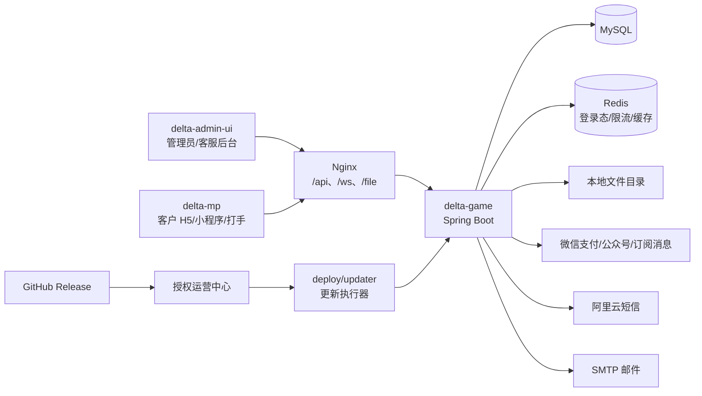
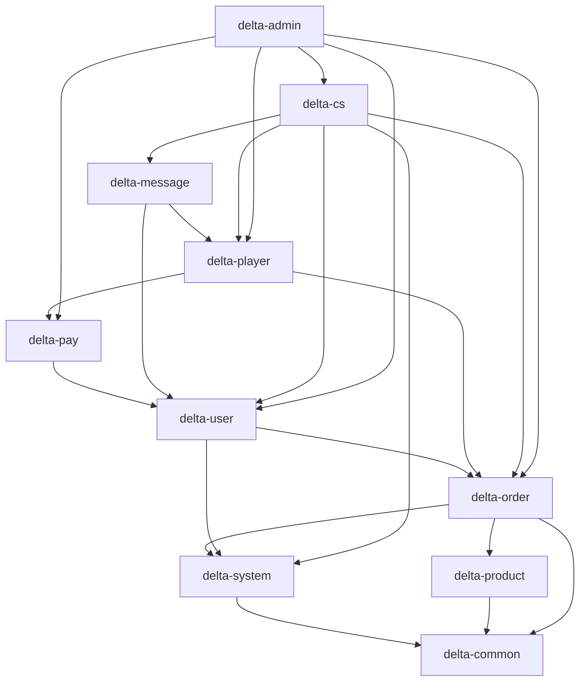
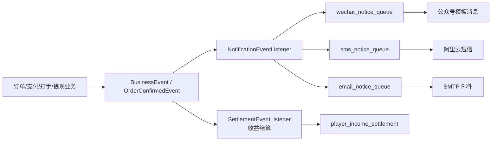
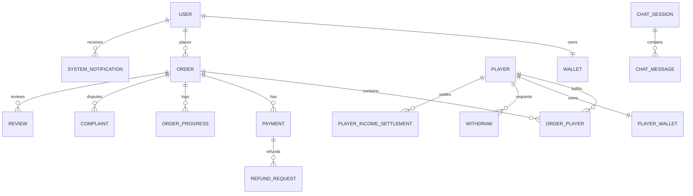
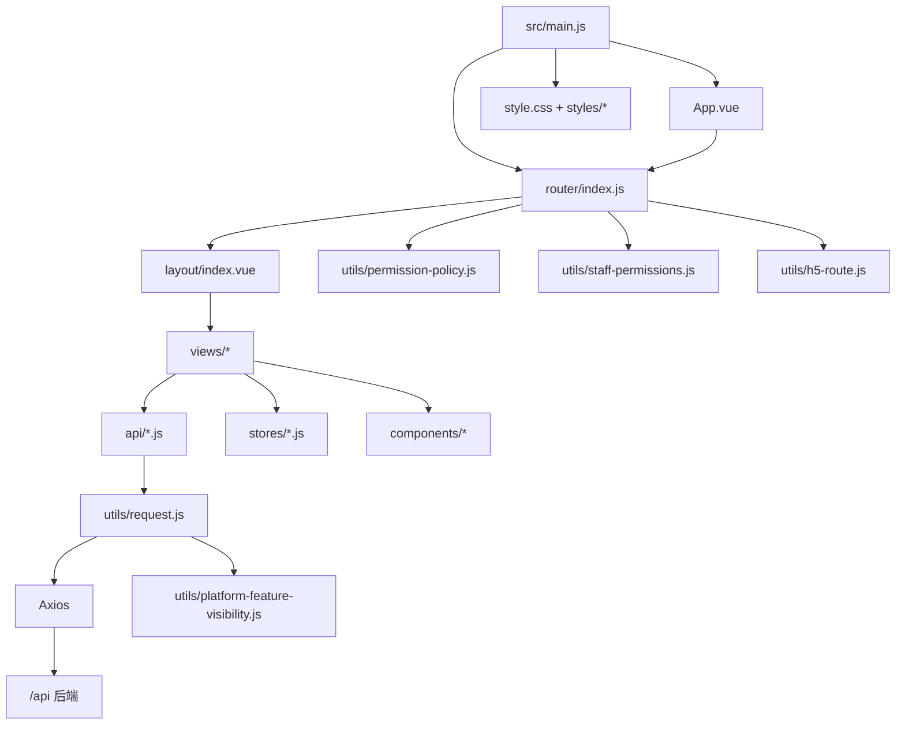
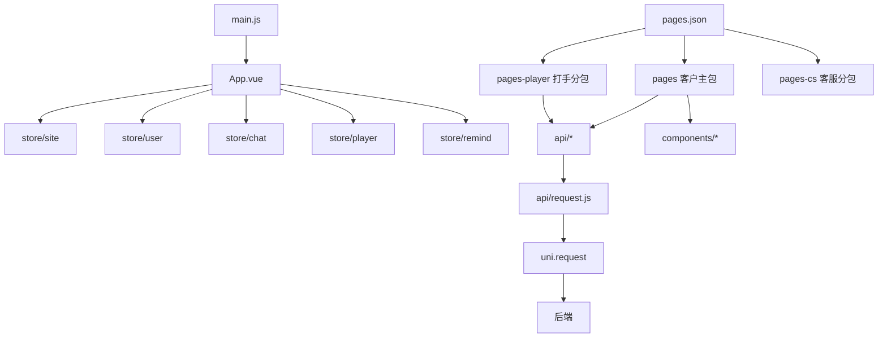

# 项目结构与文件关系

> 分析对象：`D:\codeStudy\code\cangshuo-detla`，`main` 分支；提交以 `git rev-parse HEAD` 为准。
> 当前正式版本为 `1.12.1`，对应 `delta-admin/src/main/resources/platform/catalog.json`、两个前端的 `package.json` 和 `docs/1.12.1-发布说明.md`。

客户实例、三个部署站点和授权运营中心的关系见 [客户实例与授权中心关系](客户实例与授权中心关系.md)。
AI 协作、版本和发布执行规则见 [VIBE_CODING.md](VIBE_CODING.md)。
后台 PC 与 H5 双入口的调整方案见 [后台PC与H5入口调整方案](后台PC与H5入口调整方案.md)。
共享后端、独立租户数据库的执行方案见 [多租户架构改造执行方案](多租户架构改造执行方案.md)，已落地的基础能力和未完成边界见 [多租户实施进度](多租户实施进度.md)；共享模式尚未达到生产启用条件，当前架构与生产状态仍按实际部署核对。
共享服务组模板和迁移门禁见 [多租户共享部署与迁移](多租户共享部署与迁移.md)。

## 1. 项目全貌

这是一个前后端分离的电竞陪玩、代练与护航业务平台，包含三套可部署程序：

| 部分 | 目录 | 技术栈 | 作用 |
| --- | --- | --- | --- |
| 后端 | `delta-game/` | Java 17、Spring Boot 3.5.16、MyBatis-Plus、MySQL、Redis | 唯一 API 服务，包含全部业务模块 |
| 管理后台 | `delta-admin-ui/` | Vue 3、Vite、Element Plus、Pinia | 管理员和客服的 PC 后台，同时提供 `/h5` 手机后台；`/mobile` 页面已移除，仅保留静态兼容分流 |
| 移动端 | `delta-mp/` | UniApp、Vue 3、Pinia | 客户 H5/微信小程序和打手工作台；客服入口已转到管理后台 |
| 部署与更新 | `deploy/` | Docker、Nginx、Python | 宝塔部署、SQL 迁移、发布打包和自助更新执行器 |
| 文档 | `docs/` | Markdown、HTML、SQL 说明 | 版本说明、部署教程、支付和通知配置 |



根目录的其他文件：

| 路径 | 关系 |
| --- | --- |
| `README.md` | 项目介绍和总体功能说明，部分技术栈信息已经滞后 |
| `部署文档.md` | 面向部署人员的入口说明 |
| `delta_game.sql` | 基础数据库初始化脚本，包含 46 张基础表 |
| `delta_game_recharge_migration.sql` | 单个充值相关补丁脚本 |
| `.github/workflows/ci.yml` | 后端测试构建、更新器测试、两个前端测试和构建 |
| `.tmp/` | 本地临时目录，已被 `.gitignore` 忽略 |

### 1.1 代码与文件规模

以下为 2026-11-09 在 `main` 分支 `33be107` 上实际统计的结果，不包含 `node_modules`、`dist`、`target` 等生成目录：

| 指标 | 数量 |
| --- | ---: |
| Git 跟踪文件 | 1,071 |
| Java | 467 个文件 / 28,426 行 |
| Vue | 168 个文件 |
| JavaScript | 101 个文件 |
| ES Module `.mjs` | 38 个文件 |
| SQL | 32 个文件 |
| 后端测试 | 55 个 Java 文件 / 5,703 行 |
| 管理后台源码 | 110 个文件 / 13,254 行 / 46 个 Vue 页面和面板 |
| 移动端页面 | 76 个 Vue 页面，其中 51 个在 `pages.json` 注册 |
| 部署与执行器 | 49 个文件 |

这个规模说明：后端核心复杂度集中在 `delta-admin` 和 `delta-common`；前端复杂度集中在管理后台的 46 个页面和移动端的 76 个页面文件。

## 2. 后端结构与模块依赖

后端是 Maven 多模块工程，共 10 个模块、467 个 Java 文件、约 2.84 万行 Java 代码。启动类只有一个：`delta-game/delta-admin/src/main/java/com/delta/admin/DeltaApplication.java`。

| 模块 | Java 文件 | Java 行数 | 主要职责 |
| --- | ---: | ---: | --- |
| `delta-common` | 91 | 3,708 | 通用响应、异常、JWT/安全、Redis、WebSocket 聊天、文件、短信、公众号、维护模式 |
| `delta-system` | 51 | 1,622 | 管理员、系统配置、公告、轮播、快捷回复、操作日志、日统计 |
| `delta-user` | 36 | 1,348 | 用户登录、资料、钱包、游客下单、收藏关注、游戏信息 |
| `delta-player` | 40 | 2,170 | 打手入驻、主页、接单大厅、履约、收益、提现、公开打手主页 |
| `delta-product` | 30 | 763 | 商品、分类、规格、动态下单字段、推荐分类 |
| `delta-order` | 39 | 1,572 | 订单生命周期、进度、评价、投诉、打手履约接口 |
| `delta-pay` | 22 | 2,427 | 微信支付、余额支付、充值、押金、两阶段退款、支付补偿任务 |
| `delta-message` | 12 | 409 | 站内消息和消息服务 |
| `delta-cs` | 20 | 1,646 | 客服/管理员登录、客服订单、聊天、投诉、退款、提现、换人、接力 |
| `delta-admin` | 126 | 12,761 | 唯一启动模块，同时承载后台管理接口、统计、平台授权、更新、待办和通知中心 |

模块依赖关系如下，箭头表示“前者依赖后者”：

| 模块 | 直接依赖 |
| --- | --- |
| `delta-system` | `delta-common` |
| `delta-product` | `delta-common` |
| `delta-order` | `delta-common`、`delta-product`、`delta-system` |
| `delta-user` | `delta-common`、`delta-system`、`delta-product`、`delta-order` |
| `delta-pay` | `delta-common`、`delta-system`、`delta-order`、`delta-user` |
| `delta-player` | `delta-common`、`delta-order`、`delta-pay` |
| `delta-message` | `delta-common`、`delta-user`、`delta-player` |
| `delta-cs` | `delta-system`、`delta-user`、`delta-player`、`delta-product`、`delta-order`、`delta-pay`、`delta-message` |
| `delta-admin` | `delta-system`、`delta-user`、`delta-player`、`delta-product`、`delta-order`、`delta-pay`、`delta-message`、`delta-cs` |



这套依赖没有形成循环，但不是严格分层：`delta-user` 依赖订单，`delta-player` 依赖支付。这样可以用服务接口完成跨模块业务，代价是模块之间耦合较深，阅读时需要沿着服务接口继续往下看。

### 2.1 后端文件分层

大多数业务模块按下列目录组织：

```text
controller/   接收 HTTP 请求、参数校验、返回 R<T>
dto/          请求和响应对象
service/      业务接口
service/impl/ 业务实现
mapper/       MyBatis-Plus Mapper
entity/       数据库实体
config/       模块配置
enums/        状态和类型枚举
```

调用链通常是：

```text
HTTP 请求
  -> SecurityConfig 路由鉴权
  -> JwtAuthenticationFilter 解析 JWT
  -> Controller
  -> Service
  -> Mapper
  -> MySQL
```

Redis 用于登录态、限流和缓存；上传文件写入本地目录；业务事件通过 `ApplicationEventPublisher` 发出，由 `delta-admin` 中的监听器处理结算和通知。

退款、待办、治理和部分平台数据使用 `JdbcTemplate` 直接写 SQL，以便使用 `FOR UPDATE`、多表连接和精确状态条件；这类文件不能只沿着 Mapper 查找。

### 2.2 关键公共文件

| 文件 | 作用 |
| --- | --- |
| `delta-common/.../config/SecurityConfig.java` | 所有接口的角色访问规则和公开接口白名单 |
| `delta-common/.../security/filter/JwtAuthenticationFilter.java` | 从 `Authorization: Bearer` 读取令牌并建立 Spring Security 身份 |
| `delta-common/.../security/service/TokenService.java` | JWT 签发、Redis 登录态、账号状态变更后的令牌失效 |
| `delta-common/.../exception/GlobalExceptionHandler.java` | 统一异常响应，避免把内部异常直接返回前端 |
| `delta-common/.../domain/R.java` | 统一 `code/msg/data` 响应结构 |
| `delta-common/.../mapper/CrossModuleMapper.java` | 跨模块只读查询和少量状态同步，避免模块循环依赖 |
| `delta-common/.../chat/handler/ChatWebSocketHandler.java` | WebSocket 首次认证、会话成员校验、消息落库和推送 |
| `delta-common/.../file/controller/FileController.java` | 上传与文件下载入口 |
| `delta-common/.../maintenance/MaintenanceController.java` | 系统维护状态和后台维护开关 |

`JwtAuthenticationFilter` 在每次已认证请求中通过 `TokenService.getUserContext()` 读取 Redis，并重新计算账号状态摘要。这样账号被禁用、修改密码或换绑后，旧令牌会立即失效；代价是每个已认证 HTTP 请求和 WebSocket 消息都会访问一次数据库。

### 2.3 业务模块入口

| 模块 | 主要 Controller | 关键 Service / 文件 |
| --- | --- | --- |
| `delta-user` | `UserAuthController`、`UserController`、`WalletController`、`GuestCheckoutController` | `GuestCheckoutService`、`UserPasswordService` |
| `delta-player` | `PlayerAuthController`、`PlayerController`、`PlayerOrderController`、`PlayerEarningsController`、`WithdrawController` | `PlayerGovernanceService`、`PlayerDirectoryService` |
| `delta-product` | `ProductController`、`CategoryController`、`CategoryFormFieldController` | `ProductServiceImpl` |
| `delta-order` | `OrderController`、`ReviewController`、`ComplaintController`、`PlayerWorkController` | `OrderServiceImpl`、`OrderProgressService` |
| `delta-pay` | `PayController` | `PaymentServiceImpl`、`OrderRefundWorkflowService`、`WxPaymentRecoveryTask` |
| `delta-cs` | `CsAuthController`、`CsOrderController`、`CsChatController`、`CsComplaintController`、`CsWithdrawController` | `AdminAuthServiceImpl` |
| `delta-admin` | `AdminOrderController`、`AdminPlayerController`、`AdminUserController`、`PlatformController`、`WorkbenchController` | `NotificationCenterService`、`SettlementEventListener`、`PlatformService`、`WorkbenchService` |

`delta-admin` 中还有 30 个 Controller，占全部 84 个 Controller 的三分之一以上。它既是启动模块，也是后台聚合层、统计层、通知层和更新授权层，文件集中度较高。

### 2.4 事件和通知链路



事件发布方在订单、支付、打手和客服模块；消费者主要集中在 `delta-admin`。这种写法让交易事务不直接依赖通知发送，但事件监听器和队列状态需要一起排查。

### 2.5 路由、事务和运行时结构

后端共有 84 个 Controller、81 个 Service 文件、43 个 Mapper、39 个 Entity。API 前缀并不等于模块边界：

| 路由前缀 | 实际涉及的模块 |
| --- | --- |
| `/admin/**` | `delta-admin`、`delta-system` |
| `/app/**` | `delta-admin`、`delta-player`、`delta-user` |
| `/cs/**` | `delta-cs`、`delta-admin` |
| `/order/**` | `delta-order`、`delta-player` |
| `/player/**` | `delta-player`、`delta-order`、`delta-admin` |
| `/system/**` | `delta-system`、`delta-admin` |

另有至少 12 个 Controller 没有类级 `@RequestMapping`，完整路径写在方法级注解里。因此排查接口时不能只按模块目录找，必须结合路由表、前端 `api/*` 和 Controller 全局搜索。

事务和数据访问也不是完全统一：

- 31 处 `@Transactional` 直接出现在 Controller 中，主要集中在 `delta-admin`、`delta-cs`、`delta-player` 和 `delta-order`。
- 44 个主代码 Java 文件直接使用 `JdbcTemplate`，用于行锁、多表连接、状态抢占和后台统计；不能只沿着 MyBatis Mapper 查找。

运行时还有一组分散的定时任务，覆盖订单超时、组队邀请、自动完成、提现通知、统计、缩略图清理、支付补偿、短信/公众号/邮件队列、实名清理、待结算释放、授权上报和 WebSocket 未认证连接清理。排查“为什么数据自己变了”时，要同时检查 `@Scheduled` 和 WebSocket 清理任务。

## 3. 关键业务链路与文件归属

| 业务 | 后端主要文件 | 管理端主要文件 | 移动端主要文件 | 主要数据表 |
| --- | --- | --- | --- | --- |
| 管理员/客服登录 | `AdminAuthServiceImpl`、`TokenService`、`SecurityConfig` | `views/login/index.vue`、`api/auth.js`、`stores/user.js` | `pages-cs/login/index.vue` 仅负责跳转后台 | `admin` |
| 用户登录/游客下单 | `UserAuthController`、`GuestCheckoutService`、`TokenService` | `views/user/*` | `pages/login/index.vue`、`pages/order/lookup.vue`、`store/user.js` | `user`、`wallet`、`guest_checkout_profile`、`guest_user_link` |
| 商品浏览 | `ProductController`、`CategoryController` | `views/product/*`、`api/product.js` | `pages/index/index.vue`、`pages/product/*`、`api/product.js` | `product`、`product_spec`、`category`、`category_form_field` |
| 下单与派单 | `OrderController`、`OrderServiceImpl`、`AdminOrderController`、`CsOrderController` | `views/order/OrderList.vue`、`api/business.js` | `pages/order/*`、`pages-player/hall/index.vue` | `order`、`order_player`、`order_progress` |
| 支付 | `PayController`、`PaymentServiceImpl`、`WxPayConfiguration` | `views/order/*`、`views/system/SysConfig.vue` | `pages/order/pay.vue`、`pages/wallet/*`、`api/pay.js` | `payment`、`transaction`、`wallet` |
| 退款与售后 | `OrderRefundWorkflowService`、`RefundResultListener`、`CsComplaintController` | `views/refund/RefundList.vue`、`views/complaint/ComplaintList.vue` | `pages/complaint/*`、`pages/order/detail.vue` | `refund_request`、`refund_request_audit`、`payment` |
| 打手接单与履约 | `PlayerOrderController`、`PlayerWorkController`、`PlayerGovernanceService` | `views/player/PlayerList.vue`、`views/review/FulfillmentReview.vue` | `pages-player/order/*`、`pages-player/hall/*` | `player`、`order`、`order_player` |
| 收益与提现 | `PlayerEarningsController`、`WithdrawController`、`SettlementEventListener` | `views/withdraw/WithdrawList.vue`、`views/statistics/SettlementLedger.vue` | `pages-player/earnings/*`、`pages-player/withdraw/*` | `player_wallet`、`player_income_settlement`、`withdraw`、`transaction` |
| 实时聊天 | `ChatWebSocketHandler`、`ChatServiceImpl`、`ChatController` | `views/chat/ChatService.vue`、`stores/chat.js` | `pages/chat/*`、`pages-player/chat/*`、`store/chat.js` | `chat_session`、`chat_message` |
| 通知中心 | `NotificationCenterService`、`NotificationEventListener`、`OfficialWechatController` | `views/system/WechatNotices.vue`、`views/system/EmailNotifications.vue` | 绑定页和消息页 | `system_notification`、`wechat_notice_queue`、`sms_notice_queue`、`email_notice_queue` |
| 功能授权与更新 | `PlatformController`、`PlatformService`、`PlatformRemote`、`catalog.json` | `views/platform/FeatureMarket.vue`、`views/platform/SystemUpdates.vue`、`utils/platform-feature-visibility.js` | 无独立更新入口 | `platform` 状态文件、授权中心数据 |

## 4. 数据库与表关系

`delta_game.sql` 是基础初始化脚本，包含 46 张基础表。新增功能和后续补丁还通过 `deploy/baota/migrations/` 下的 16 个 SQL 文件、`delta-game/delta-admin/src/main/resources/db/migration/` 下的 4 个 SQL 文件，以及启动时执行的 `DatabaseCompatibility` 补齐。

把所有基础脚本、迁移和兼容建表合并去重后，仓库内共有 65 个不同的建表名称。`DatabaseCompatibility` 启动时会确保 14 张表存在，并补充 25 个字段；因此生产表结构不能只看 `delta_game.sql` 的 46 张表。

核心关系如下。注意，基础脚本没有物理外键，图中的关系是代码维护的逻辑关系和索引关系。



表可以按职责分为以下几组：

| 分组 | 表 |
| --- | --- |
| 账号与人员 | `admin`、`user`、`player`、`player_level`、`staff_shift`、`guest_checkout_profile`、`guest_user_link` |
| 商品与内容 | `product`、`product_spec`、`category`、`category_form_field`、`recommend_category`、`banner`、`notice`、`content_config` |
| 订单与履约 | `order`、`order_player`、`order_progress`、`order_relay_request`、`player_replace_request`、`review`、`complaint` |
| 支付与资金 | `payment`、`refund_request`、`refund_request_audit`、`transaction`、`wallet`、`player_wallet`、`withdraw`、`player_income_settlement` |
| 聊天与消息 | `chat_session`、`chat_message`、`system_notification`、`subscribe_message_log`、`wechat_notice_queue`、`sms_notice_queue`、`email_notice_queue` |
| 配置与统计 | `sys_config`、`statistics_daily`、`analytics_daily_visitor`、`operation_log`、`sensitive_word`、`quick_reply` |

`order`、`payment`、`refund_request`、`system_notification` 都建立了状态或时间索引；退款还使用唯一键 `uk_refund_request_active_order` 和请求幂等键防止重复申请。由于没有数据库外键，删除、合并和跨表状态同步主要依赖服务层和测试保证。

## 5. 管理后台结构与文件关系

入口链路：

```text
index.html
  -> src/main.js
  -> App.vue
  -> router/index.js
  -> layout/index.vue
  -> views/<业务页面>.vue
```



| 目录/文件 | 关系 |
| --- | --- |
| `src/main.js` | 创建 Vue 应用，注册 Element Plus、Pinia、路由和全局图标 |
| `src/App.vue` | 根组件，展示全局加载和错误提示；不再按窗口宽度自动切换路由 |
| `src/router/index.js` | 桌面路由、移动路由别名、登录守卫、角色/权限/付费功能守卫 |
| `src/layout/index.vue` | PC 侧栏、顶部栏、手机宽度下的导航抽屉、聊天和待办角标 |
| `src/layout/H5Layout.vue` | H5 独立移动外壳：顶部标题/返回/账号、底部五项导航、账号抽屉和异常页壳 |
| `src/components/StaffAvatar.vue` | 工作人员头像：上传头像优先、品牌 Logo 次之、品牌首字回退 |
| `src/views/` | 46 个 Vue 页面和面板，按订单、用户、打手、退款、投诉、聊天、系统等目录组织 |
| `src/api/` | 接口封装；`business.js` 汇总 77 个后台接口，`product.js`、`system.js` 等按领域拆分 |
| `src/utils/request.js` | Axios 实例、Token 注入、统一错误提示、加载状态、付费功能请求拦截 |
| `src/utils/permission-policy.js` | 路由到权限码的映射 |
| `src/utils/staff-permissions.js` | 从 `/cs/permissions` 加载当前员工权限并提供 `can()` |
| `src/utils/h5-route.js` | 为桌面路由生成 `/h5` 别名，处理 PC/H5 深链和 H5 会话内规范；内部规范链接保留 H5 历史记录 |
| `src/utils/platform-feature-visibility.js` | 读取授权中心功能开关；权限和付费授权同时满足才显示功能 |
| `src/stores/` | 登录用户、站点配置、聊天、待办等全局状态 |
| `src/components/` | 图片上传、分页、批量操作、通知模板编辑、富文本编辑器等复用组件 |

管理端目录分布：`views/system` 12 个页面，`views/product` 5 个，`views/player` 4 个，`views/chat`、`views/dashboard`、`views/user`、`views/platform` 各 3 个，其余为订单、退款、投诉、履约、统计等页面。`src/api` 有 11 个文件、147 个导出函数，其中 `business.js` 一个文件就有 77 个后台接口；`components` 15 个、`stores` 4 个、`utils` 24 个。路由文件中约有 74 个 `path` 定义，还会为桌面路由批量生成 `/h5` 别名。

PC 和 H5 使用不同外壳：PC 走 `layout/index.vue`，手机宽度继续保持 PC URL、桌面仪表盘和顶部导航抽屉；H5 走 `layout/H5Layout.vue`，固定使用 `/h5` 前缀、移动工作台和底部导航。H5 的 403、404 也在移动外壳内，返回按钮优先回到上一 H5 页面，直接深链打开时回到 `/h5/dashboard`。列表表格在 768px 以下转卡片时，滚动视图必须恢复块级全宽，否则卡片会缩成内容宽度。

管理后台的权限判断有两层：路由 `meta.roles` 控制管理员/客服范围，`meta.permission` 和 `meta.feature` 控制细粒度员工权限和付费功能。后端仍会在 `SecurityConfig`、`@PreAuthorize` 和业务服务中再次校验，前端隐藏菜单不作为安全边界。

## 6. 移动端结构与文件关系

入口链路：

```text
main.js (createSSRApp)
  -> App.vue (onLaunch/onShow/onHide)
  -> pages.json 决定编译页面、分包和 tabBar
  -> pages/、pages-player/、pages-cs/
  -> api/*.js + store/*.js + components/*
```



| 目录 | 内容 |
| --- | --- |
| `pages/` | 客户主包：首页、分类、商品、下单、支付、订单、钱包、评价、投诉、聊天、消息、协议 |
| `pages-player/` | 打手分包：入驻、主页管理、接单大厅、订单履约、收益、提现、评价、邀请 |
| `pages-cs/` | 客服分包；目前只有 `login/index.vue` 注册为页面，作用是提示并跳转到独立工作人员后台 |
| `api/` | 20 个业务接口模块和 `request.js` 请求封装，覆盖订单、支付、打手、客服、聊天、商品、游客、通知等 |
| `store/` | 角色、登录、聊天、打手、提醒、站点配置 |
| `utils/` | 角色 Token、请求地址、图片、WebSocket、短信提醒、按角色入口等 |
| `components/` | 商品卡、打手卡、订单卡、聊天气泡、自定义 tabBar、支付二维码等 |
| `pages.json` | 页面注册、分包、标题、下拉刷新和 tabBar，是构建入口清单 |
| `manifest.json` | 微信小程序 AppID、版本名/版本码和平台配置 |

页面注册情况：客户主包 31 页、打手分包 19 页、客服分包 1 页，共 51 个注册页面，底部 tabBar 5 项。仓库中实际有 76 个页面 Vue 文件，25 个未注册，其中 23 个是已退役的 `pages-cs` 业务页，另外 2 个是 `pages/agreement/index` 和 `pages-player/index/index`。未注册页面不会进入构建产物。

`App.vue` 启动时恢复角色、加载站点配置、恢复登录资料，并按角色连接聊天和轮询提醒。移动端共用一套 `api/request.js`，按 `app_role` 读取对应用户、打手或客服 Token。

## 7. 配置、部署和更新链路

| 层 | 文件 | 说明 |
| --- | --- | --- |
| 后端默认配置 | `delta-game/delta-admin/src/main/resources/application.yml` | 激活环境、启动管理员、平台授权接口 |
| 开发环境 | `application-dev.yml` | 本地 MySQL、Redis、上传路径、Swagger |
| 生产环境 | `application-prod.yml` | 生产数据源、关闭 Swagger、上传目录、微信支付配置 |
| 生产安全校验 | `delta-admin/.../config/ProductionSecurityValidator.java` | 启动时拒绝默认密码、短 JWT、非 HTTPS 来源 |
| 前端环境 | `delta-admin-ui/.env.*`、`delta-mp/.env.*` | API 基础地址和部署差异 |
| 容器部署 | `deploy/baota/docker-compose.yml`、`nginx.conf`、三个 `Dockerfile` | MySQL、Redis、后端、后台、H5 五个服务 |
| 部署变量 | `deploy/baota/.env.example` | 数据库、Redis、JWT、AES、实名、微信支付、上传目录 |

```text
delta-game/delta-admin/target/delta-admin.jar
  -> delta-game/Dockerfile
  -> backend 镜像

delta-admin-ui/dist/
  -> delta-admin-ui/Dockerfile
  -> admin 镜像

delta-mp/dist/build/h5/
  -> delta-mp/Dockerfile
  -> h5 镜像
```

生产 Nginx 的关系：

- `/` 返回对应前端静态文件，找不到路径时回退到 `index.html`。
- `/api/` 去掉前缀后转发到 `backend:8080`。
- `/ws/` 升级为 WebSocket，长连接超时为 3600 秒。
- `/file/` 代理上传文件并启用 30 天缓存，缩略图隐藏目录直接返回 404。
- 微信支付回调页单独放宽 CSP，允许后端生成的内联引导脚本。

自助更新的关系：

```text
package_release.py
  -> 后端、后台、H5 三个 ZIP
  -> release-manifest.json（Git commit、工作区状态、SHA-256）
  -> GitHub Release
  -> 授权中心读取 Release 摘要并签发更新计划
  -> 管理后台“系统更新”页面
  -> worker.py 验证 Ed25519 签名、摘要和组件版本
  -> 备份 MySQL/文件，切换发布目录，健康检查，失败回退
```

更新执行器不执行任意数据库迁移；数据库结构由 `DatabaseCompatibility` 在启动时补齐新增字段和索引，复杂变更仍需要单独迁移。

## 8. 测试与持续集成

| 范围 | 位置 | 规模 |
| --- | --- | --- |
| 后端 | `delta-game/delta-admin/src/test/` | 55 个 Java 测试文件，约 5,703 行 |
| 管理后台 | `delta-admin-ui/test/` | 62 个 Node 测试 |
| 移动端 | `delta-mp/test/` | 86 个 Node 测试 |
| CI | `.github/workflows/ci.yml` | Maven 验证、更新器签名测试、两个前端测试和构建 |

后端测试覆盖认证、订单退款、结算恢复、游客下单、实名认证、公众号授权、支付场景隔离、移动后台和工作台等。前端测试以源码契约、状态流转和页面行为为主。

本次验证：管理后台 62 项、移动端 86 项全部通过；后端使用 Temurin JDK 17.0.21 和 Maven 3.9.11 完成 55 个测试报告、273 项测试，0 failures / 0 errors。系统默认 Java 25 不能直接用于该项目。

## 9. 结构上需要关注的地方

| 事项 | 现状 | 影响 |
| --- | --- | --- |
| README 与实际依赖不一致 | README 写 Spring Boot 3.2.0，实际 `pom.xml` 为 3.5.16 | 新成员容易按错误版本排查 |
| README 目录说明过期 | README 写 `docker-deploy/` 和 `test_seed_data.sql`，实际部署目录是 `deploy/baota`，仓库中也没有该测试数据文件 | 部署和初始化入口容易找错 |
| 移动端遗留页面 | `pages-cs/` 有 23 个业务页没有写入 `pages.json`，当前构建产物中也不存在；`pages/agreement/index` 和 `pages-player/index/index` 同样未注册 | 这些页面不可访问，属于已迁移到管理后台后的遗留代码；`pages/workbench` 仍保留部分旧链接 |
| `delta-admin` 过于集中 | 126 个 Java 文件、30 个 Controller，同时承担启动、后台业务、统计、通知、授权和更新 | 模块边界不够清晰，后续拆分时容易牵动启动模块 |
| 管理端接口聚合 | `api/business.js` 一个文件导出 77 个后台接口 | 页面依赖集中，命名和权限映射容易分散 |
| API 命名空间跨模块 | `/admin`、`/app`、`/cs`、`/order`、`/player`、`/system` 都横跨多个 Maven 模块 | 按 URL 排查接口时必须跨模块搜索，不能假设前缀等于模块 |
| 数据访问双轨 | 44 个主代码 Java 文件直接使用 `JdbcTemplate`，MyBatis XML 为 0 | 复杂 SQL、行锁和状态抢占不会出现在 Mapper XML 中，排查要同时看 Service 和 SQL |
| 定时任务分散 | 14 个以上 `@Scheduled` 分布在 `delta-common`、`delta-pay`、`delta-admin`，另有 WebSocket 清理任务 | 数据自动变化时不能只查用户请求，还要查定时任务 |
| 数据库演进来源多 | 基础 SQL、两套 migration 目录、启动兼容类同时存在 | 新环境、老环境升级和测试环境的表结构可能不一致 |
| 没有物理外键 | 基础表只有索引，没有 `FOREIGN KEY` | 应用层必须保证删除和状态同步，数据修复需要额外脚本 |
| 每次请求校验账号状态 | JWT 过滤器会访问 Redis 并查询账号表计算摘要 | 安全性和即时失效能力较好，但高并发时数据库压力会上升 |
| Controller 中存在事务 | 31 处 `@Transactional` 直接出现在 Controller，主要集中在客服、打手订单和后台管理 | 与 `controller -> service` 的约定不完全一致，复用和测试成本较高 |
| H2 与 MySQL 差异 | 后端集成测试主要使用 H2 | SQL 方言、锁和索引行为可能与生产 MySQL 不同，复杂查询仍需要真实库验证 |

## 10. 推荐的阅读和修改顺序

第一次阅读建议按以下顺序：

1. `README.md` 和 `docs/1.12.1-发布说明.md`，了解当前版本和最近变更。
2. `delta-game/pom.xml` 和 `DeltaApplication.java`，确认模块和启动入口。
3. `SecurityConfig.java`、`JwtAuthenticationFilter.java`、`TokenService.java`，理解登录态和权限边界。
4. 选择一条业务链路阅读，例如 `OrderController -> OrderServiceImpl -> OrderMapper`。
5. 再看 `PaymentServiceImpl` 和 `OrderRefundWorkflowService`，理解支付回调和两阶段退款。
6. 管理后台从 `src/router/index.js -> layout/index.vue -> views/order/OrderList.vue -> api/business.js -> utils/request.js` 阅读。
7. 移动端从 `pages.json -> App.vue -> pages/order/detail.vue -> api/order.js -> api/request.js` 阅读。
8. 最后看 `delta_game.sql`、`deploy/baota/migrations/` 和 `DatabaseCompatibility.java`，确认数据结构和升级方式。

修改功能时可以先按下面的对应关系定位文件：

| 要改的功能 | 首先查看 |
| --- | --- |
| 登录、Token、权限 | `SecurityConfig`、`JwtAuthenticationFilter`、`TokenService`、`staff-permissions.js`、`permission-policy.js` |
| 订单状态 | `OrderStatusEnum`、`OrderServiceImpl`、`OrderController`、`views/order/*`、`pages/order/*` |
| 支付和退款 | `PayController`、`PaymentServiceImpl`、`OrderRefundWorkflowService`、`RefundList.vue`、`pages/order/pay.vue` |
| 打手入驻和接单 | `delta-player`、`AdminPlayerController`、`views/player/*`、`pages-player/*` |
| 聊天 | `ChatWebSocketHandler`、`ChatServiceImpl`、`views/chat/*`、`pages/chat/*` |
| 通知 | `NotificationCenterService`、`NotificationEventListener`、`OfficialWechatController`、`WechatNotices.vue`、`EmailNotifications.vue` |
| 功能授权和更新 | `PlatformController`、`PlatformService`、`catalog.json`、`utils/platform-feature-visibility.js`、`deploy/updater/` |
| 数据库字段 | 先改 `DatabaseCompatibility`，同步 migration，再改 entity/mapper 和测试 |
